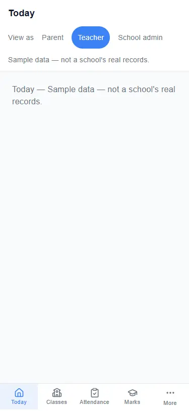
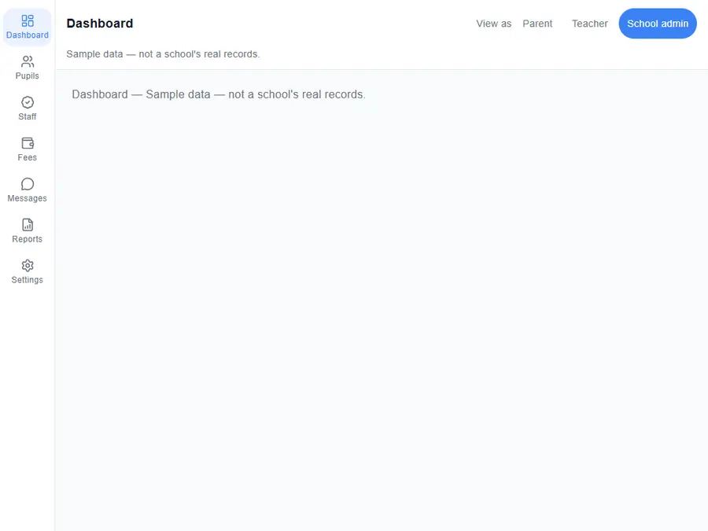
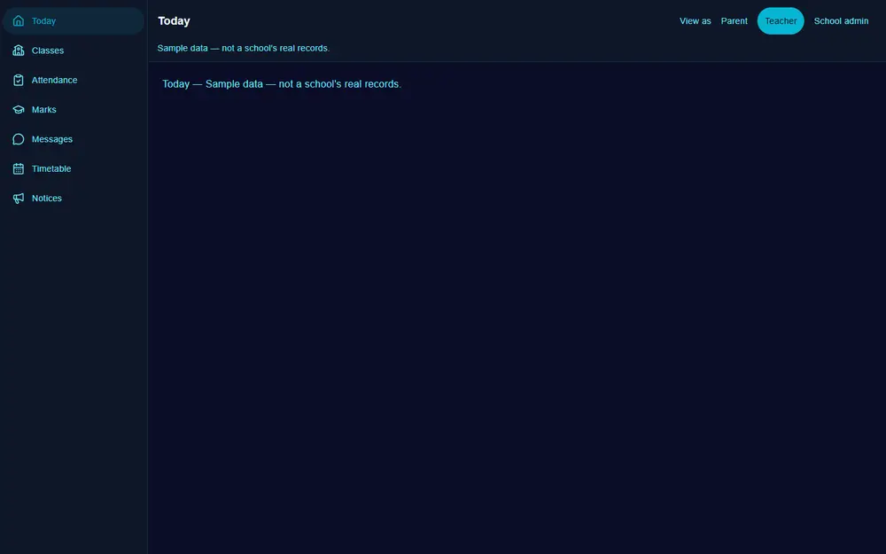
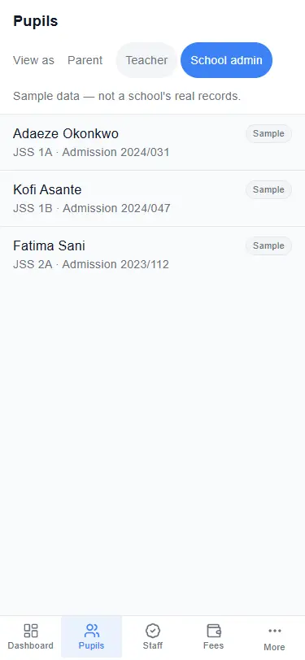
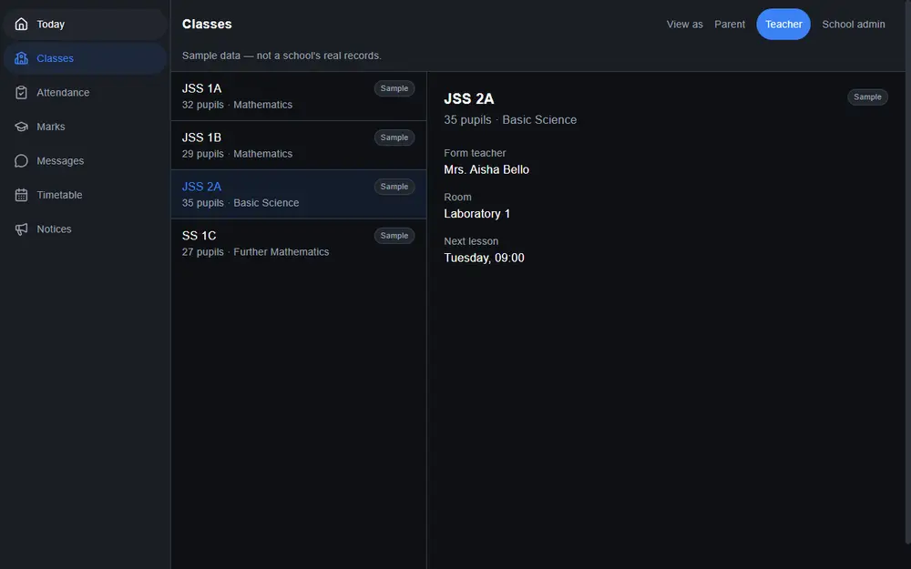
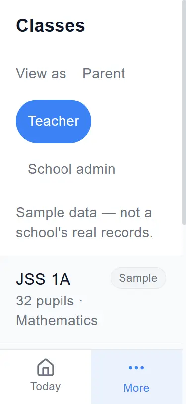
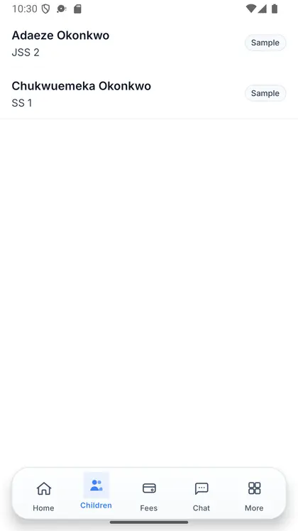
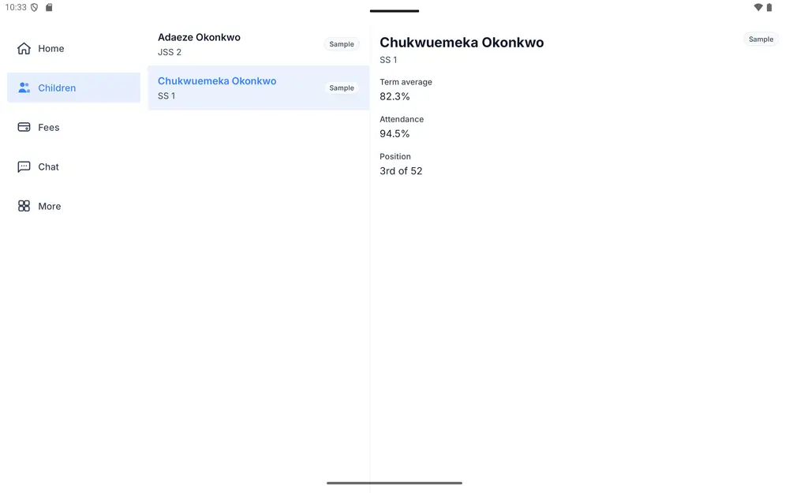
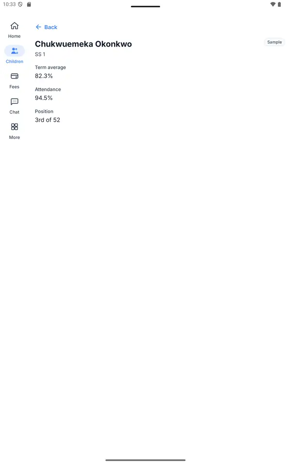
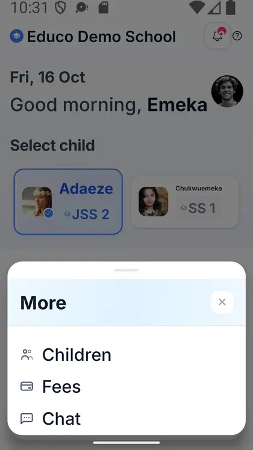

# How the Educo app lays itself out

The Educo app is the same app on a parent's phone, a teacher's tablet and the school office's computer. It does not
shrink one layout to fit them all. It looks at the screen it is on and arranges itself for it: where its menu goes,
whether a list and its detail sit side by side, and how many places fit along the bottom.

## On a phone: the bar along the bottom

Mr Okonkwo opens the app on his phone. Along the bottom is the **bar**: Home, Children, Fees, Chat and More. The place
he is on is lit up. A bar holds at most five places, the number a thumb can reach.

A teacher's menu has seven places: Today, Classes, Attendance, Marks, Messages, Timetable and Notices. Seven do not
fit along the bottom of a phone, so the bar shows the first four and a fifth called **More**. Tapping **More** opens
the other three. With the keyboard, the arrow keys walk along the bar, **Enter** opens More, the arrows walk its list,
and **Escape** puts it away and puts you back on More.

When he turns his phone on its side, the bar stays. A phone on its side is wide but very short, and a bar along the
bottom still takes the least room.

## On a tablet: the rail down the side

Mrs Mensah uses a tablet. From 600 pixels wide, a bar along the bottom wastes the width, so the app puts its places in
a **rail** down the left side, each icon over its word. Turned upright or sideways, a tablet keeps the rail.

## On a computer: the sidebar

From 1200 pixels wide there is room for the words beside the icons. The rail becomes a **sidebar**.

## A list and its detail

Some places are lists: a parent's Children, a teacher's Classes, the office's Pupils. Each row opens its detail.

**On a phone** there is room for one of them at a time. Tapping *JSS 2A* opens its detail, with **Back** at the top.
Back (or the phone's own back button) returns to the list, scrolled to where it was.

**From 840 pixels wide** (a tablet on its side, a laptop, a desktop), the list sits beside the detail of the first
row. Tapping another row swaps the detail beside it.

Every row has its own address, so a link to one class opens straight on it: on a phone as the detail with Back, on a
wide screen with both panes and that row chosen. If the window narrows and widens again, the same row stays open.
A list with nothing in it says *Nothing here yet.*, and an address for a row the list does not have says so.

## Larger text

A parent who has made the text larger on their phone gets the same app, with larger words. The app measures the
screen in that text size. At twice the size, a phone has room for two readable places along the bottom, not five, so
the bar shows the first one and **More**, and More holds the rest. No word in the bar or the rail is ever cut short or
broken in the middle.

## In the Educo app on a phone and a tablet

The phone and tablet app follows the same rules. On a phone, the Children tab is the list and a child is its detail.
On a tablet held sideways, the list and the child sit side by side. Turned upright, the tablet shows one child, with
Back, and the rail stays.

At a large text size, the phone app's bar holds the places that fit, and **More** opens a sheet with the rest.

## Sample data

Until the app is connected to a school's records, its lists show **sample** rows. Every one of them is marked
*Sample*, and the teacher and admin menus say *Sample data — not a school's real records.* You can see each role's
layout at `/app-preview/parent`, `/app-preview/teacher` and `/app-preview/admin`, with **View as** to switch.

---

## Reference

### Which layout a screen gets

| The screen | Navigation | A list and its detail |
|---|---|---|
| Under 600 wide, or under 480 tall (a phone, a phone on its side) | Bar along the bottom | One at a time, with Back |
| 600 to 839 wide | Rail down the side | One at a time, with Back |
| 840 to 1199 wide | Rail down the side | Side by side |
| 1200 wide and up | Sidebar | Side by side |

The widths are CSS pixels at the reader's text size: with the browser's text at twice the size, a 1280 window is laid
out as a 640 one.

### The bar

- It holds as many places as fit at the reader's text size, at most five.
- When a role has more places than fit, the last spot is **More**, which holds the rest, in order.
- The place you are on is marked for a screen reader too (`aria-current`), and More is marked while you are on one of
  its places.

| Key | What it does |
|---|---|
| ← → (bar) · ↑ ↓ (rail, sidebar) | Move between places; from the last one, back to the first |
| Home · End | The first place · the last one |
| Enter | Go to the place, or open More |
| Escape | Put More away, back on More |

### The website builder's screens

The builder's screen sizes moved to the same lines: **Tablet** from 600, **Laptop** (tablet held sideways) from 840,
**Desktop** from 1200 and **Wide** from 1600 (they were 900 and 1800). A page saved before keeps everything it had set
for each screen; a setting made for "Tablet landscape" now starts at 840 instead of 900, and one for "Big desktop" at
1600 instead of 1800.

### Where the settings live

Every number on this page lives in a settings file, so changing it never means changing the app:

| File | What it holds |
|---|---|
| `config/layout.json` | The screen sizes, the height that makes a screen "short", which navigation each gets, where a list and its detail split, how wide the rail, the sidebar and a bar place are, and the room a screen leaves for the bar |
| `config/app-shell.json` | Each role's places, in order: the word, the icon and where it goes; which places open a list; the words the app shows |
| `config/sample-lists.json` | The sample rows, until the app is connected to a school's records |
