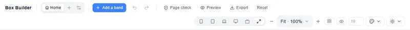
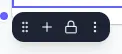
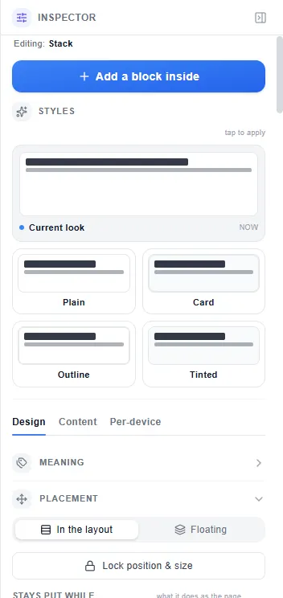
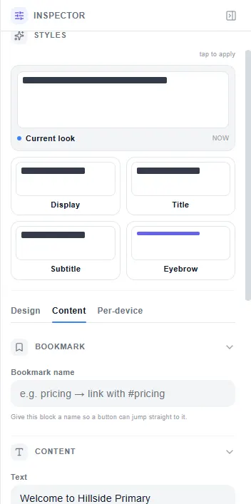
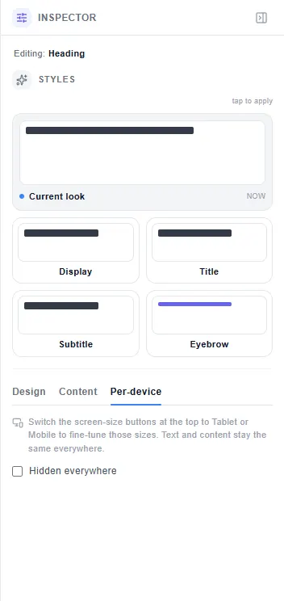
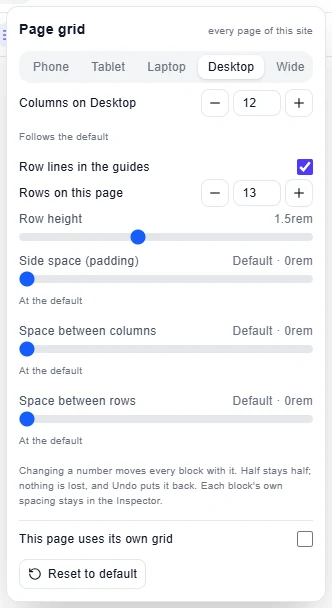

# Layout — reference

This is the control-by-control reference for the builder's layout panels. For scenarios and explanations see
[Layout — the story](/).

Controls are grouped by where they live. A control that appears in more than one block type is described once and
cross-referenced.

---

## Top bar

On a screen narrower than 1,600px, **Add a band**, **Page check**, **Preview**, **Export** and **Reset** show only
their icons (+, shield, eye, download, a turning arrow), so the bar stays one row on a 1280px desktop. (On a touch screen every button is a finger's size, 44px, so there the bar is
one row from 1,366px and two rows at 1,280px, with the words from 1,800px.) Each keeps its
name as a tooltip and for screen readers.

| Control | What it does | Shortcut |
|---------|-------------|---------|
| **Page tabs** (Home · **+** Add page · Page settings) | Switch between the site's pages, add one, rename or delete one. The page's menu also has **Line up with the grid** (every block of this page to the nearest whole column, on the screen you are editing; blocks placed free stay put; one Undo), **Page grid…** and **Site fonts** (Headings · Words, each font saying which of Yoruba, Igbo, Hausa and Twi / Ga / Ewe it writes — see the Website Builder guide) | **Esc** closes it |
| **+ Add a band** | Adds a full-width band at the bottom of the page; you can drag it to any position after. | — |
| **Undo** | Reverses the last change. | Ctrl / Cmd Z |
| **Redo** | Re-applies the last undone change. | Ctrl / Cmd Y, or Ctrl / Cmd Shift Z |
| **Page check** | Lists what to fix before publishing: pictures missing a description, heading levels out of order, lines too tight for their words. The badge counts them. | — |
| **Preview** | Opens the real published page. Close it with **Exit preview**; **H** hides the Preview's own controls. | — |
| **Export** | Downloads `site.zip`: one HTML file per page, a shared `styles.css`, your fonts in `fonts/` and your uploaded pictures in `images/` (with smaller copies for phones). | — |
| **Reset** | Starts the whole site over — every page replaced by one blank page. It asks first, and Undo puts the site back. | — |
| **Device chips** (Mobile 375 · Tablet 768 · Laptop 1024 · Desktop 1280 · Wide 1920 · Full width) | Switches the canvas to that screen. At Desktop or Full width you edit the base design (Full width draws the desktop page, 1200px wide, shrunk to fit the room, so what you see is what you edit on any screen); a change at Mobile, Tablet or Laptop applies from that screen down; Wide keeps its own. | — |
| **Zoom** (− · Fit · +) | Zooms the canvas; **Fit** fits the whole page width in the window. | — |
| **Layout guides** (the grid icon) | Draws the page grid's column and row lines over the canvas, and opens the **Page grid** panel. | — |
| **Show hidden blocks** (the eye) | Draws blocks hidden at this screen faintly, so you can select and edit them. Click again to hide them. | — |
| **Base size** (the number box, 10 by default) | The size in px everything on the canvas scales from, so words stay readable when you zoom. | — |
| **Website theme** (the palette) and **Editor appearance** (the sun) | The site's own colours and type, saved with it · the builder's light / dark look, for you only. | — |
| **Blocks** (the button at the canvas's left) | Opens or closes the Blocks panel — docked at the side on a laptop or larger, floating over the canvas on a smaller screen. | **B** |

---

## Blocks panel

Drag a tile onto the page and let go where the dashed marker shows, or click a tile to add it after the selected block.

**Add | Layers** at the top switches the panel to the page's **layers**: every block in reading order, inside the box it sits in. A row selects its block, is dragged to move it (top or bottom of a row: before or after; the middle of a box: inside), renamed (**F2**), hidden on the screen being edited (the eye), locked (the padlock), and its **⋮** menu has Duplicate · Move up · Move down · Delete. **Select several** makes each tap add a block, for a touch screen.

| Section | Block | What it makes |
|---------|-------|--------------|
| **Layout** | Stack | Things one under another. |
| | Side by side | Things in a row. |
| | Grid | Things across and down, sized like a table insert (sweep across × down). |
| | Spacer | Adjustable blank space. |
| | Divider | A horizontal rule (solid, dashed, dotted). |
| | Hero | One full-screen photograph with headline. |
| | Rotating hero | Several full-screen photographs in turn. |
| **Text** | Heading | Titles — Display, Title, Subtitle, Eyebrow styles. |
| | Text | Paragraphs — Body, Lead, Caption, Quote styles. |
| | Button | A call-to-action link. |
| | List | Bulleted or numbered. |
| **Media** | Image | One photograph or image. |
| | Photo gallery | Many photographs at once, set up in one dialog. |
| | Slider | Photographs shown one at a time with dots. |
| | Video | YouTube, Vimeo, or MP4. It keeps its shape at every screen size — 16:9 unless you pick **Portrait** (a phone-shaped video) or type a **Height**. On the published page a YouTube or Vimeo video shows its picture and a play button, and the player only loads when a visitor presses play — so the page stays light on a phone and on mobile data. |
| | Icon | A searchable symbol (inline SVG). |
| | Embed | Raw iframe or HTML pasted in. |
| **Components** | Accordion | Expandable Q&A. |
| | Alert | One urgent message (closure notice, open day…). |
| | Card | Image + heading + text + button. |
| | Quote | Testimonial with author. |
| | Stat | Big number + label. |
| | Badge | Small pill label. |
| | Rating | Star rating display. |
| | Pricing | Pricing plan card. |

---

## Block toolbar

Appears just above (or below) the selected block.

| Button | What it does | Shortcut |
|--------|-------------|---------|
| **⠿ Drag to move** | Drag the grip — or simply press on the block itself and drag — to a new place. A copy follows the pointer, the blocks along its stack or row slide aside to show its place (elsewhere a line shows it), and the chip names the place ("Above · Button: …"); it glides in when you let go. A **section** carried over another section moves above or below it (by which half the pointer is over) — hold still over it for about half a second to put it **inside** instead. On a touch screen hold the block still for a quarter of a second to lift it. **Escape** puts it back. Words being edited (double-click, Edit text, Enter, F2) take a press-and-drag for selecting words. Every move is announced to a screen reader. | Esc (cancel) |
| **+ Add a block inside** | Nests a new block inside this one. | — |
| **🔒 Lock position and size** | Freezes the block's place and size; click again to unlock. | — |
| **📏 Show spacing** | Draws every space of the block at once, each with its words and size; click again to hide them. With a mouse it is on the toolbar; on a phone or tablet it is in **⋮** (a finger has no hover). | Alt + P |
| **✏️ Edit text** | On a title, a text, a button or a link: puts the caret at the end of its words so you can type. Words also say **Click to type** under the pointer, and one click types. | Enter or F2 |
| **🖼 Replace picture** | On a picture, and on any block whose background is a photo (the welcome at the top of the home page): choose a photo from this device to put in its place. One Ctrl+Z puts the old one back. An empty picture says **Add a picture**. | — |
| **⋮ Block actions** | The menu below. | — |

The **⋮ Block actions** menu:

| Item | What it does | Shortcut |
|------|-------------|---------|
| **Move up** / **Move down** | One place earlier / later in its container. | ↑ / ↓ |
| **Show spacing** / **Hide spacing** | Every space of the block at once (see *Spacing on the canvas*). | Alt + P |
| **Duplicate** | An identical copy directly after it. | Ctrl / Cmd D |
| **Copy** · **Cut** · **Paste** | The usual clipboard, for blocks. | Ctrl / Cmd C · X · V |
| **Delete** | Removes the block and everything inside it. | Delete / Backspace |
| **Float on top** / **Return to flow** | Lifts the block out of the layout to place it freely, or puts it back. | — |
| **Bring to front** · **Bring forward** · **Send backward** · **Send to back** | Layer order of floating blocks. | — |
| **Ungroup** | Takes the blocks out of a group. | Ctrl / Cmd Shift G |

Click a block to select it; click again to go inside it; **Escape** steps back out one level.

**The trail** — the top line of the Inspector, "Editing: Section › Stack › **Heading**", names the boxes around
the selected block, outermost first, ending with the block itself. A ready-made section is called a **Section**. Each name before it is a button that selects
that box (click, tap, or **Tab** then **Enter**). It lists the same boxes **Escape** steps out through; a block
straight on the page shows its name alone.

---

## Inspector — Design tab

Above the three tabs, **Styles** shows ready-made looks for the selected block as live previews; tap one to apply it.

### Arrange (Stack / Side by side / Grid only)

Stack, Side by side and Grid are one block in three arrangements; these switch between them without losing what is
inside.

| Control | What it does |
|---------|-------------|
| **Kind**: Stack · Side by side · Grid | What the box is — blocks down the page, across it, or across *and* down in columns. Changing it keeps every block, in order (a Stack's blocks share the line as a Side by side; a Side by side becomes a Grid of a column each). What has no meaning in the new kind is named under it: *"Left behind: column spans."* One **Ctrl+Z** takes it back. A component's own box keeps **Direction** and **Arrange as**. |
| **Position blocks**: Start · Center · End · Spread out · Space around each · Even spacing | Where the blocks sit along the Direction when there is room to spare — at the start, the middle or the end; spread to both ends; the same room on both sides of each block (half at the ends); or the same room everywhere, the ends included. When the blocks already fill the row (two at 50 %, or one set to Fill) there is no room to place them in, and the Inspector says so: *"These blocks fill the row — give one a width to place them."* Set one to **Fit** or a smaller width and they move. |
| **Let blocks wrap to a new line** | A row that runs out of room carries its blocks onto the next line instead of squeezing them. |
| **Wrapped lines**: Fill · Top · Middle · Bottom · Spread out · Even spacing (while wrap is on, a side-by-side row) | Where the lines sit when the box is taller than they need — give it a height to see it. Fill shares the height between them. |
| **Line up**: Fill · Start · Center · End · Text lines up | Where the blocks sit across a stack, or down a row or a grid. **Text lines up** (a row or a grid only) puts their first lines of words on one line — a price and its unit, a heading and its link. |
| **Content width** (a section of the page): Edge to edge · Centred column | Edge to edge runs the section's content the full width; Centred column puts it on the centred column — the site's **Content width** when one is set (Page grid panel), which a section with no choice of its own follows; the Inspector says which. | Every screen |
| **Column widths** (a Grid): Share · Fit content · Set width · Between, one per column you see | Share takes a share of what the others leave; Fit content is as wide as what is in it; Set width is exactly the width typed (e.g. `15rem`); Between is at least one width and at most another (`12rem` – `18rem`). Drawn where the Grid shows all its columns; where it shows fewer (a phone) the columns are equal. Needs every block of the Grid to be the same number of columns wide. | Every screen |
| **Columns** (a Grid): A set number · As many as fit (+ Each at least, e.g. `16rem`, + **At most across**) | A set number: the Grid's column count. As many as fit: as many blocks across as fit at that width on every screen, equal and filling the row, one a line on a narrow phone; **At most across** is its ceiling (0: no limit), set on one screen to change it there only; the count, Column widths and each block's columns wide stand aside. | Every screen |
| **When it doesn't fit** (a Side by side): Wrap to new lines · Scroll sideways | Scroll sideways keeps every block on one line that visitors swipe or scroll: each block keeps its width (`min(80%, 18rem)` when it has none of its own), a part of the next one shows, a swipe lands a block at the start. The page itself never scrolls sideways. Keyboard users reach the strip with Tab and move it with the arrow keys. Per screen — a strip on a phone, wrapped lines on a desktop. |
| **Overlap the section above** (a page section with one above it): Off · Small · Medium · Large · Extra large | Pulls the section up over the foot of the one above (2 · 4 · 6 · 8 rem) and draws it in front. The section above grows by the same amount, so none of its words are covered. Per screen. |
| **Show one at a time** | Turns any container into a pager — children become pages, visitors swipe between them. |
| **Edge shape**: Top · Bottom — Straight · Slope right · Slope left · Curve out · Curve in | Cuts the band's top or bottom edge into a slope or a curve, shown as little pictures; **Edge depth** sets how deep. The shape cuts the background, never the size; a Shadow follows the shape. |

### Size (every block)

| Control | What it does | Notes |
|---------|-------------|-------|
| **Width** | The block's share of its row, as a fraction (e.g. 3 of 6) or a fixed rem value. **Custom** takes a % (a share) or a set width such as `20rem`: a set width stays exactly that wide and the other blocks of the row share the rest; where they no longer fit, the row stacks. Drag the block's left or right edge to change it; the opposite edge stays fixed. | Per screen |
| **Columns (of 12)** (page-grid rows) | How many of the page's columns the block spans on this screen, in halves; the block beside it gives what this one takes. | Per screen · Alt ← / → (Shift: half) |
| **From line** (page-grid rows) | The column line where the block starts. Changing this moves the left edge; the right edge stays. | Per screen |
| **To line** (page-grid rows) | The column line where the block ends. Changing this moves the right edge; the left edge stays. | Per screen |
| **Whole line** (page-grid rows) | Spans every column on the current screen. Adapts if the column count changes. | Per screen |
| **To the last line** (page-grid rows) | Sets the right edge to the last column boundary, from wherever the left edge is. Adapts with column count. | Per screen |
| **Bleed to the page edge** (page-grid rows): Off · Left · Right · Both | Extends the block past the page's side space to the page's physical edge on that side. | Per screen |
| **Free inside its columns (% of them)** Left / Right (Alt-drag) | Fine position within the block's columns, as a percentage. Appears after an Alt-drag. | Per screen |
| **Back on the lines** (Alt-drag) | Snaps a free-positioned block back to its column boundaries. Clears the left / right margins. | — |
| **Rows tall** (page-grid rows) | How many grid rows this block spans. 1 is the default; 2 or more makes it cover multiple rows. | Per screen |
| **Height** | A minimum height for the block, in rem or px. Not available on all block types. | Per screen |
| **At least rows tall** (bands) | For a page-grid page's outer band — the band is at least this many row-heights tall. | Per screen |
| **Proportion**: Free · 1:1 · 4:3 · 3:2 · 16:9 · 2:1 · 21:9 · 3:4 · 2:3 · 4:5 · 9:16 · Custom (w : h) | The block keeps this shape: as tall as its width says. Words that need more room make it taller, never cut; a picture is cropped to it. Picking one clears the Height; typing a Height clears it. Free turns it off. | Per screen |
| **Limits**: Min width · Max width · Min height · Max height | A length (`40rem`, `65ch`, `80%`; px is made rem). Never wider than the screen; a Max height caps a stretched or full-screen block but never cuts words. On a picture it caps the picture itself, cropped (`75svh`: three quarters of the screen's height). On a row of the page, a Min / Max width makes a sidebar between two widths. Empty clears it. | Per screen |

**Dragging an edge or a corner back.** Every edge and corner can be dragged back, in the same drag or a later one: the
block — and every neighbour the drag moved — returns to the width and height it had and stores nothing new (no fixed
height, not "sized by hand"). Within 2px of where an edge started counts as where it started. An edge stops where the
neighbour across it has nothing left to give: a one-column grid cell with cells after it, the grid's own left edge, a
column already at the width its words need. Ctrl+Z undoes a drag even if the caret was in the block's words. These
thresholds (the 2px, the 3rem and 14rem column floors) are set in `config/layout.json` (`resize`, `columns`).

### Position (every block with a parent)

| Control | What it does |
|---------|-------------|
| **The nine squares** | A shortcut: top-left … bottom-right sets Across and Down at once. Click the chosen square again to let the block sit where the layout puts it. |
| **Across**: Auto · Start · Middle · End · Fill | Where the block sits across its parent. Fill stretches it across; along a row it grows into the free room. |
| **Down**: Auto · Top · Middle · Bottom · Fill | Where the block sits down its parent. Fill stretches it to the parent's height (one card as tall as its row). |
| **Push to the far end** (a block in a row or a stack) | Moves the block — and the blocks after it — to the far end: a menu's last links, a card's button to the card's foot. It needs room to move into. |
| **Wrap words round it** (a picture in a top-to-bottom Stack): Off · Start · End | The picture sits at the line's start (or end) and the words after it run beside it, then back under it. It keeps a width of its own (a rem, or a % under 100); the new picture's 100% takes 40% instead, never more than half the words' reading width. In a Stack narrower than 30rem the picture stops floating — it takes the whole line, or keeps its own width in rem — and the words follow it. |
| **Words follow** (shown while the words wrap): Its box · Its round corners · A cut-out's outline | What the lines keep to. Its box: the picture's rectangle. Its round corners: the corners the picture has (Rounded corners, or the Circle style), a 1rem gap all round the curve. A cut-out's outline: the opaque part of a picture with a see-through background, traced by the builder when chosen (and again when the picture is replaced) and written into the page — nothing more to download — a 1rem gap. A picture from another site that does not allow it to be read keeps to its box. Can be set per screen. Where its Stack is under 30rem the picture stops floating; one with its own width in rem keeps it there. |
| **Space round it** (shown while the words wrap): a slider on the spacing scale, 0 up to 2.8rem on a phone (5.6rem on a wide screen) · **Back to default** | How far the words keep from the picture — beside it, under it, and round its curve or outline when Words follow one. Unset it is the default 1rem ("Default · 1rem"); a step you choose grows with the screen and the reader's text size like every other space. 0 brings the words right up to it. Can be set per screen (a smaller space on Mobile, say). Arrow keys move it a step, Home and End to the ends. |
| **Order** | Where it comes in the sequence, per screen. It moves what is seen, not what is read: the **Page check** names a block whose Order makes the two differ, and the screens. |

Each applies to the screen you are editing.

### Placement

| Control | What it does |
|---------|-------------|
| **In the layout** (default) | The block takes its place in the page's normal layout. |
| **Floating** | The block is lifted off the layout; you drag it to any position. Other blocks ignore it. On a phone it goes back into the layout. |
| **Stays put while scrolling** | **Scrolls away** (default) · **Sticks when reached** (it keeps its own space and holds when it reaches the top) · **Floats on screen** (lifted off the page, held at an edge or corner of the window). |

### Meaning (semantic role)

| Control | What it does |
|---------|-------------|
| **Page header** | Wraps the block in `<header>`. |
| **Navigation** | Wraps the block in `<nav>`. |
| **Main content** | Wraps the block in `<main>`. |
| **Sidebar** | Wraps the block in `<aside>`. |
| **Page footer** | Wraps the block in `<footer>`. |
| **Heading level** | For Heading blocks — the h1 / h2 / h3 / h4 level in the published HTML. |
| **What is this block?** on a Text | **Paragraph** (`
`), **Quote** (`<blockquote>`, quoted words) or **Small print** (`<small>`, fine print). |
| **What is this block?** on a Picture | **Picture** (``) or **Figure with a caption** (`<figure>` with `<figcaption>`). The caption is typed under the picture on the page, or in **Caption** here; the page publishes it as a figure once the caption has words. |
| **What is this block?** on a List | **Bulleted** (`<ul>`) or **Numbered** (`<ol>`). |
| **What is this block?** on a Button | **Link — goes to a page** (`<a href>`) or **Button — does something here** (`<button>`). |

An Icon, a Divider and a Link mean one thing each, so they have no Meaning to choose.

### Spacing

| Control | What it does | Notes |
|---------|-------------|-------|
| **Space between blocks** | The space between the blocks inside this container, across and down at once. A slider on the spacing scale (0 · 0.25 · 0.5 · 0.75 · 1 · 1.25 · 1.5 · 2 · 2.5 · 3 · 4 · 5 · 6 rem — every spacing slider moves in these steps; the side fields take any value). None on a block made since 15 October 2026; about 1rem on one saved before. | Per screen |
| **Space across** · **Space down** | The same space, across and down separately — "same as above" until you move one. | Per screen |
| **Space between columns** (page-grid rows) | The gap between blocks side by side in a page-grid row (across). | Per screen |
| **Space between rows** (page-grid rows) | The gap between wrapped lines of a page-grid row (down). | Per screen |
| **Inner spacing** (padding) | Space between the block's edge and its content, all sides at once or each side separately. Each side is typed in rem, sized for a laptop: the space grows a little on wide screens and closes up on a phone. It holds between 0 and the slider's largest size. Shows "Default · …rem" and a **Back to default** button. | Per screen |
| **Outer spacing** (margin) | Space outside the block's edge, all sides at once or each side separately, in rem, from 0 up. Shows "Default · …rem" and a **Back to default** button. | Per screen |

*A block made since 15 October 2026 has no space until you add it — every control starts at 0. A block saved before keeps
the default it was made with; its controls show "Default · …rem" and **Back to default** returns to it.*

### Spacing on the canvas

When one block is selected you see its outline and its **size handles** — nothing else. A space shows itself where the
pointer is: move into the space inside the top of a block and that space alone lights up, saying **"Space inside · 2rem"**,
with its handle. **Show spacing** (toolbar, **⋮**, or **Alt + P**) shows every space at once. Nothing here is published.

On each side the three handles keep their own places, never touching: the **size** handle at the middle (just outside the
edge), the **inner space** handle a quarter along, the **outer space** handle three quarters along. A space handle with no
room clear of the others is not drawn — its side is still set in the Inspector.

| On the canvas | What it does | Notes |
|---------------|-------------|-------|
| **Inner space** (a green band and handle inside each edge, "Space inside") | The padding on that side. Drag the handle — or the band — inward to add, outward to take away. The band shows its words and size. | Not on a Button or a component, which keep their design's inner space; not on an empty box (its + is there) |
| **Outer space** (an orange band and handle outside each edge, "Space outside") | The margin on that side. | Not on a floating block |
| **Space between columns · Space between rows** (a pink hatch and handle between the blocks inside) | The space between them, across and down. | Writes "Space between blocks", or the across / down value once they differ |
| **Steps** | Every drag lands on the spacing scale: 0 · 0.25 · 0.5 · 0.75 · 1 · 1.25 · 1.5 · 2 · 2.5 · 3 · 4 · 5 · 6 rem. | — |
| **Shift** while dragging | Bigger steps (every other one of the scale). | — |
| **Alt** while dragging | The opposite side moves too (top + bottom, left + right). | — |
| **Alt + Shift** while dragging | All four sides move together. | — |
| **Double-click** a band or handle | That space back to none. | — |
| **Undo** | One Undo takes back a whole drag. | — |
| **Keyboard** | Each handle is a slider ("Inner space, top: 1rem"). **↑ / →** one step more, **↓ / ←** one fewer, **Shift** two steps, **Home** none, **End** the most. | Tab reaches them after the block toolbar |

*A drag changes the screen the canvas is showing, as the Inspector does. A click on a handle that does not move goes to the
words under it — so a handle lying over a block's first letters never stops you typing there.*

### Size on the canvas

| On the canvas | What it does |
|---------------|-------------|
| **Size handle** (a blue pill just outside the middle of each edge; a dot at each corner) | Point at it and it says **"Drag to change the height"** (or width, or size). It can be grabbed anywhere from the edge out to about 1.5rem beyond it. |
| **Dragging an edge** | Only that edge moves — the opposite edge stays where it is, even for a centred block (the builder writes the space that holds it, which you see as its outer space). A label beside the pointer shows the size, **width × height**. |
| **As small as its content** | No block becomes smaller than what is inside it — its words, a button's label on one line. The label says **"as small as its content"** when it gets there. A picture is the exception: it is cropped to the size you drag, and a picture with a set proportion turns **Free** (the Proportion control puts it back). |
| Past its content: it moves | Keep dragging and the block **moves** that way: its top or left edge pushes it down or right, opening space before it ("Space above · 2rem"); its bottom or right edge brings it back, closing that space. Where its edge is shared with the block next to it, that block grows instead, so no gap ever opens. Dragged back in the same movement, it returns to where it was. |
| Cards in a grid of cards | Every card resizes together, so they stay even: the bottom and top edges set every card's height; the side edges set how many go across. When you let go, a bar says **"All 6 cards resized"** — press **Just this one instead** to give the size to that card alone. Ctrl+Z undoes either. |
| Words in a widened paragraph | A paragraph keeps lines short enough to read; once you drag its width yourself, its words use the width you gave it. The Page check still warns past 75 characters a line. |

### Background

| Control | What it does |
|---------|-------------|
| **Colour** | Fills the block with a solid colour from the site's design tokens (or a custom hex / OKLCH value). |
| **Gradient** | A gradient between two or more colours, with direction. |
| **Image** | An uploaded photograph or pattern as a background. |
| **Overlay** | A semi-transparent colour layer over a background image (to keep words readable). Strength: 0–100%. |
| **Pattern / Grain** | A noise or grid texture over the background. |

### Shadow, Border, Radius

| Control | What it does |
|---------|-------------|
| **Shadow** | Adds a drop shadow: size, blur, spread, colour. |
| **Border** | A visible outline: width, style, colour. |
| **Corner radius** | Rounds one or all corners independently, in rem. |

---

## Inspector — Content tab

(Available on Text, Heading, Button, Image, List, and component blocks.)

| Control | What it does |
|---------|-------------|
| **Text / Label** | The editable text for this block. Click the block on the canvas to edit inline instead. |
| **Link** | For Button and Heading — the URL the block links to (a page name, or a full URL). |
| **Describe this image** | The alt text for an Image block. Read aloud to users who cannot see it. |
| **Load straight away** | Turns off lazy loading for an Image — use only for images at the very top of the page. |
| **Show the whole picture (don't crop it)** | Ticked: the block takes the photograph's own proportions. Unticked: crops to the Height you set. |
| **Fill the block's height** | Shown for an Image that is the only thing in a block spanning 2 or more rows, and for an Image that is itself a cell of a Grid (not one whose Row heights follow the picture, nor one shown one at a time). On (the default): the picture fills the block's whole height, cropped from its centre, never stretched and never shorter than its own height. Off: it keeps its own height. Per screen, like **Rows tall**. |
| **Bookmark** | An anchor name — the block can be linked to directly using `#bookmark`. |

---

## Inspector — Per-device tab

| Control | What it does |
|---------|-------------|
| **Hidden on phone** (the name follows the device chip: phone, tablet…) | The block is gone at that screen — no space taken, nothing moved — on the canvas and on the published page. **Show hidden blocks** (the eye in the top bar) draws it faintly so you can select it. |
| **Hidden everywhere** | Hides the block on every screen; tick it, then untick "Hidden on phone" at the Mobile chip to show it on phones only. |
| The yellow note "Editing Phone…" | Says which screen your size, spacing and layout changes apply to, with **Reset phone changes to default**. |
| **Set on Phone** (the name follows the screen) | Every value set on this screen, by name, each with its own **Reset** — the screen then shows what the wider screens have. On the other tabs the same values are marked **● Set here** beside their control (press it to reset), and a value taken from a wider screen says **From Tablet landscape**. |

---

## Page grid panel

Opened by the **Layout guides** button in the top bar (the grid icon), or right-click the canvas → **Page grid…**.

The page grid's columns are also drawn, without the switch, while the **page** or a **grid** is selected — select something else
and they go again. **Layout guides** (Shift+G) keeps them on whatever is selected.

| Control | What it does | Notes |
|---------|-------------|-------|
| **Phone · Tablet · Laptop · Desktop · Wide** | Which screen the settings below are for — and the canvas switches to that screen, so you see what you change. | — |
| **Columns on …** (− / number / +) | The number of columns on that screen. Default 12 from a tablet up, 6 on a phone. Every block keeps its share (half stays half); Undo puts it back. The lines on the canvas change as you click. | Per screen |
| **Row lines in the guides** | Draws the row lines as well as the column lines. Changing the rows or the row height turns them on. | — |
| **Rows on this page** (− / number / +) | Divides the page, as tall as it is now, into that many rows; the row height follows. A page grows with what is on it, so the count changes as you add blocks. | — |
| **Row height** | The height of one grid row (default 1.5rem) — what **Rows tall** counts in. Set it, and the row count follows. | — |
| **Side space (padding)** | Room at the page's four edges. A page made since 15 October 2026 has none until you add it; pages made before keep 1–1.25rem. While you hold the slider the space is shaded on the page with its size. | All four sides |
| **Space above and below sections** | One size for every section of the site — the room above and below its content, from none to 6rem. Unset, each section keeps its own design's space; **Back to the designs' own** returns to that. The header and the footer keep theirs. A section whose top or bottom you drag, or change in the Inspector, keeps its own space (**Follow the site** gives it back). With **This page uses its own grid**, a page has its own. | Each section |
| **Same-colour sections share their space** | On (the start): two sections of the same colour, one under the other, have one space between them, not two. A photo, a border, rounded corners or a shadow keep both. Off: each keeps its own. | Each pair of sections |
| **Space between columns** | Gap between blocks side by side (across). None until you add it on a new page. Shaded on the page, with its size, while you hold the slider. | Per screen |
| **Space between rows** | Gap between blocks one under another — the page's own rows on a new page, and lines that wrap. None until you add it. Shaded while you hold the slider. | Per screen |
| **Content width**: Full width · Centred (+ a slider, 40–100rem, 75 to start) | Full width: sections run edge to edge inside the side space. Centred: every section of every page sits its words and pictures on one centred column of this width — backgrounds still edge to edge, the layout guides drawn inside it. A section set **Edge to edge** in the Inspector opts out. | Every screen |
| **This page uses its own grid** | The settings above apply to this page only; unticked, they are shared by every page of the site. | — |
| **Reset to default** | Puts every setting in the panel back to its default. | — |

The panel sits at the right of the window, over the Inspector, so it never covers the page you are changing; on a phone or a
tablet it opens inside **More**.

**Words at the edge.** On a page with no side space, words can sit right on the page's edge. **Page check** says so (a
suggestion — it never stops you publishing) and its **Add space at the sides** button sets the side space to about 1rem on a phone.

Each setting reads "At the default" or "Follows the default" until you change it.

---

## Keyboard shortcuts (complete list for layout)

| Key | What it does |
|-----|-------------|
| **B** | Open / close the Blocks panel |
| **Ctrl / Cmd Z** | Undo |
| **Ctrl / Cmd Y** or **Ctrl / Cmd Shift Z** | Redo |
| **Ctrl / Cmd D** | Duplicate selected block |
| **Ctrl / Cmd C · X · V** | Copy · cut · paste a block |
| **Ctrl / Cmd G** · **Ctrl / Cmd Shift G** | Group the selected blocks where they are · Ungroup them back where they were |
| **Shift + click** | Add a block to the selection, or take it out |
| **Ctrl / Cmd Alt C** · **Ctrl / Cmd Alt V** | Copy a block's style · paste it onto the selected blocks (this screen only) |
| **L** | Open the left panel's **Layers** |
| **↑ ↓ ← → · Home · End · Enter · F2 · Shift F10** (in Layers) | Move between rows · open / close a box · first / last · select · rename · the row's menu |
| **Ctrl / Cmd L** | Lock or unlock the selected blocks' position and size |
| **Alt F** | Float the block, or put it back in the layout |
| **Ctrl / Cmd ]** · **[** (Shift: to the front / back) | Bring a floating block forward · send it back |
| **Shift G** | Layout guides on / off (not while you are typing) |
| **Alt ← / →** (Shift: half) | A block of a page-grid row takes one column more / fewer, said aloud ("5 of 12 columns") |
| **Enter** or **F2** | Start typing in the selected block |
| **Delete / Backspace** | Delete selected block |
| **Escape** | Step out to the parent block; close the Blocks panel, a menu, or the Inspector (below laptop width) |
| **Tab** | Move focus to the next interactive element |
| **Shift + drag edge** | Snap to half-column lines (page-grid rows) |
| **Alt + drop / drag edge** | Free-position inside columns (page-grid rows) |
| **↑ / ↓** (block selected) | Move a block in the layout one place earlier / later — several selected move together |
| **↑ ↓ ← →** (floating block) | Nudge it 2px (12px with Shift) |
| **↑ → / ↓ ←** (a spacing handle focused) | That space one step more / fewer (Shift: two); **Home** none, **End** the most |
| **Shift / Alt / Alt + Shift** + drag a spacing handle | Bigger steps · the opposite side too · all four sides |
| **Double-click** a spacing band | That space back to none |
| **H** (in Preview) | Hide or show the Preview's own controls |

---

## How controls change per screen

Many controls are **per screen**: the value you set at Desktop applies to Desktop only; the value at Mobile applies
to Mobile only. The cascade works like CSS: a value set at a wider screen applies to narrower screens too, unless
you override it at that narrower screen. **Wide is the exception** — it branches off Desktop, so what you set at Wide
stays on big screens and never reaches the narrower ones.

The device chip in the top bar shows which screen you are editing. The Inspector labels a control "(per screen)"
when it supports this. Controls without that label apply to all screens equally.

---

*See also:* [Layout — the story](/) for scenarios and explanations · [Website Builder](website-builder) for
content blocks, media, components, themes, Preview and export.
