# Ready-made sections, your own sections and page templates

A page is a stack of **sections**: a header, a welcome, a few bands of words and pictures, a footer. You can build each one
block by block (the [layout story](./layout-story.md) shows how), or start from one that is already made and change it to
suit your school. This page is about starting from something made.

## "I want a welcome at the top of the home page"

Mr Boateng opens the **Add** panel (the **+** at the top left, or the **B** key) and chooses the **Sections** tab. The panel
shows the kinds of section as a row of chips: **Headers 8 · Hero / Welcome 36 · Footers 19 · Blank 1 · Our story 16 · Text 8 ·
Features / Services 20 · Spotlight / zig-zag 17 · Stats 8 · CTA / Banner 17 · Cards 21 · Programmes / Products 12 ·
Gallery / Collage 14 · Slideshow 7 · Team 10 · Testimonials 8**, each with how many it holds, under small
headings (Navigation, Opening, Story, Showing, People and trust, Action). He taps
**Hero / Welcome**.

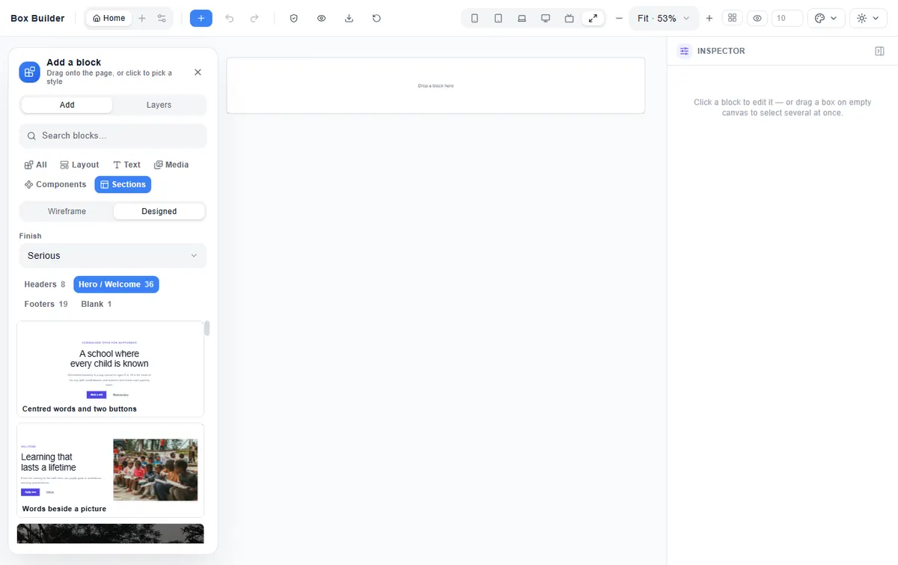

Every tile is the real section, drawn small: what you see on the tile is what the page will show. He clicks **Words beside a
picture**. The section appears under the one he was working on, as a whole band of the page, and it is selected so he can
see it at once. If nothing was selected, it goes at the end of the page, above the footer.

- **Click** a tile, or **Tab** to it and press **Enter**, or **tap** it on a phone or tablet.
- **Drag** a tile onto the page to put it somewhere else: a line shows where it will land, between two sections. A section
  never lands inside another block.
- **Ctrl+Z** takes it away again in one step.

## "Plain, or finished?"

At the top of the tab, **Wireframe | Designed** chooses how the tiles look:

- **Wireframe** shows the structure only: grey picture boxes and words like "Title goes here". It is for when you know what
  you want to write and will choose the look yourself.
- **Designed** shows a finished look, with real school words and photographs of African schools, ready to change.

With **Designed**, the **Finish** chooses one of seven looks. Each one is a different personality for the whole page:

| Finish | What it feels like |
|---|---|
| Serious | Light, elegant headings, spaced capitals, no rounded corners, dark bands instead of colour |
| Minimalist | Black on white, small and exact, no colour blocks |
| Plain | Neutral and structured, small type, thin borders |
| Bold | Big heavy capitals and blocks of the school colour |
| Calm | Soft colours, gentle headings, rounded corners and pictures |
| Startup | Light grey bands, rounded cards with a soft shadow |
| Playful | Heavy round headings, very rounded corners, lots of colour |

Every finish uses your website's theme (Light, Dark, Midnight or Purple), so a section always matches the rest of your site.
The typeface is your site's too: choose it once in **Page settings → Site fonts**.

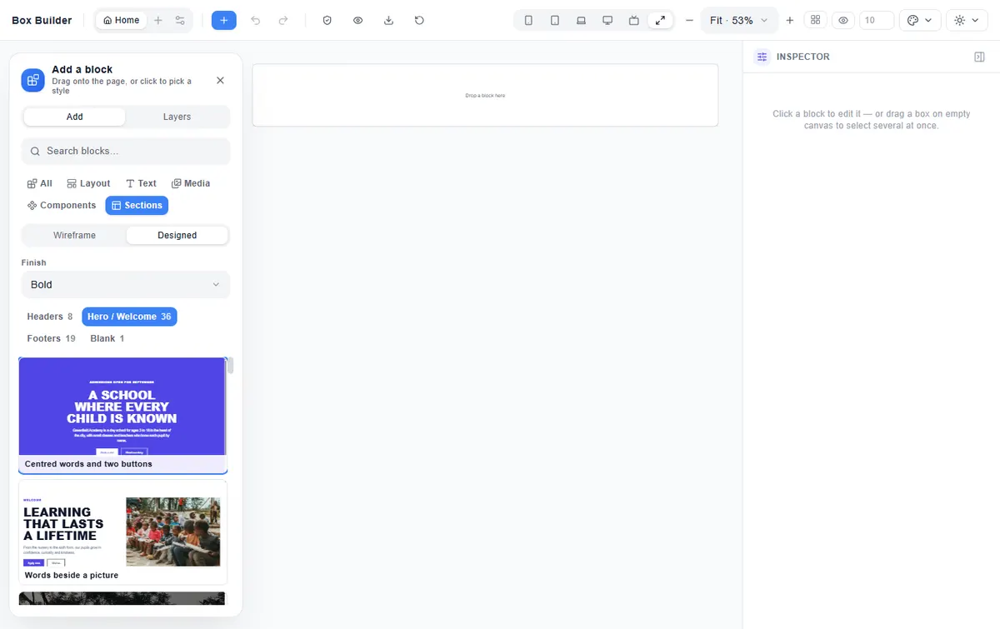

## "Our story, what we offer, our numbers, and a call to come and see us"

A section is a band of the page you are on, never a page. That is why the kinds are named as sections (**Our story**, not
"About"): the About *page* is something you make with **Add a page**, from a template. The top of the Sections tab says so,
and its **Add a page** button opens that dialog.

Under the welcome, most school pages tell the same few things. Mrs Okafor builds her About page from them, one tile at a
time:

- **Our story** (16): the school's story beside a photo, a word from the head, a big statement on the school colour, a card of
  words on a full photo, four numbered pictures of the campus.
- **Text** (8): words with nothing else to say: an introduction beside three points, a title beside two paragraphs, a list
  of links for parents, nine subjects with an icon each.
- **Features / Services** (20): what the school offers, as cards with a photo, icon cards, numbered points, a checkerboard
  of words and photos, or four points beside a photo.
- **Spotlight / zig-zag** (17): a picture beside words, and rows that swap sides as you read down the page.
- **Stats** (8): the school in numbers, on a band, over a photo, or beside a picture.
- **CTA / Banner** (17): the invitation at the end of a page: "Book a tour", "Apply now", a one-line notice, an offer
  beside a picture.

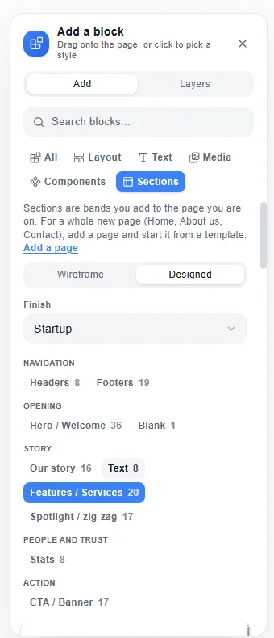

She does not set anything for phones; each kind already does what good school sites do on a small screen:

- **A zig-zag puts the picture first on a phone**, whichever side it sits on a computer. The words still read in the same
  order, so a screen reader hears the heading first.
- **Cards go three across on a computer, two on a tablet, and one under another on a phone.** A row of cards is never
  more than the design asks for, so six cards are two rows of three on a big screen, not four and two.
- **Four numbers are two by two** on a phone and a tablet held upright, and one row from a tablet held sideways.
- **A button beside some words goes under them on a phone**, the full width, easy to tap.
- **A column that takes part of the row fills the whole line on a phone**, so nothing is left ragged at the right.

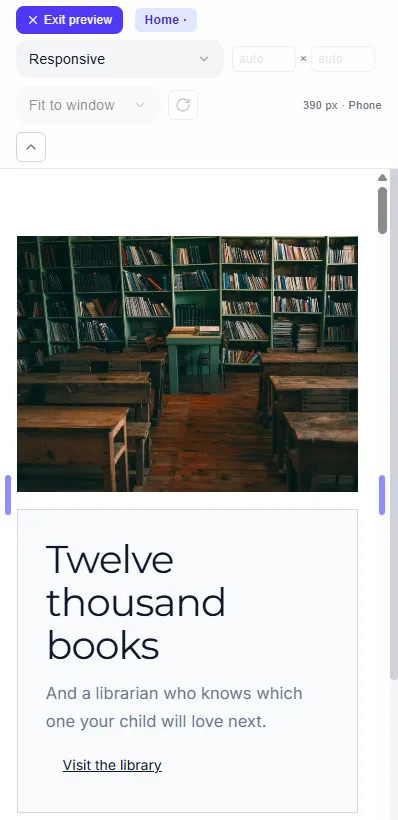

## "Our clubs, our photos, our staff, and what parents say"

Further down a page, a school shows what it is like to be there. Mr Mensah makes the school's Life at Greenfield page
from these:

- **Cards** (21): three or four cards of a photo and words, people's cards with their name and how to reach them, numbered
  cards, icon cards on grey, words beside a grid of cards, and one big card beside four small ones.
- **Programmes / Products** (12): nursery, primary and secondary, clubs, summer school or the uniform shop, as photo cards
  with a fee, a panel of photos, words beside one big picture, or numbered points beside a photo.
- **Gallery / Collage** (14): photos of school life two or three across, one big photo beside four small ones, photos of
  different shapes set like a wall, and collages of photos and words.
- **Slideshow** (7): photos one after another with words over each, a picture beside its words on every slide, words only,
  or an introduction that stays put beside slides that change.
- **Team** (10): the head and the staff as portraits with their name and role, round faces in a list, a big statement over
  four people, or a list of who to call.
- **Testimonials** (8): what parents, pupils and old students say, as three cards, one big quote with five stars, portraits
  with their words, a wall of quotes, or quotes one after another.

Again, nothing to set for phones:

- **A gallery's big photo stays big.** On a computer it covers two columns and two rows of its grid; on a tablet and a phone
  the grid narrows by itself and the big photo comes first. Select it and change **Columns wide** in the Inspector if you want
  it smaller.
- **A slideshow shows one slide at a time.** A visitor swipes it, or uses the arrow keys, the arrows or the dots. Only one of
  the seven moves by itself, every 8 seconds, and it stops while someone points at it, is using it with the keyboard, or has
  pressed **Pause**. For a visitor who has asked their phone or computer for less movement, it never moves by itself.
- **Portraits and cards never leave one alone on a line.** Four people are four across on a computer, two and two on a
  tablet, and one under another or two by two on a phone.
- **Every slide, card and photo is ordinary blocks.** Add a fifth slide by duplicating one (**Ctrl+D**), change a person's
  photo, or delete a card you do not need.

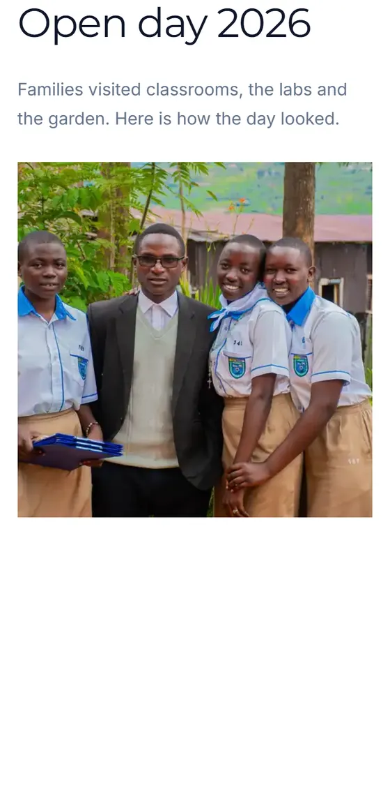

## "Who we work with, our fees, the questions parents ask, and how to reach us"

Mrs Owusu, the admissions officer, makes the Admissions page. Parents ask the same things every term, so she puts the answers
where they can find them:

- **Logos / Clients** (8): the exam boards, the ministry and the partners the school works with, as names in a bordered grid,
  a centred row, round badges for accreditations, or quotes over a strip of partners. Each partner is its **name** until you
  put its logo in; a logo you add asks for its words, so a screen reader still says who it is.
- **List** (5): our clubs or subjects as rows of a picture and words, the school day as times beside what happens, the term's
  dates as a list of days, or a two-column list with **Read more** on each.
- **Contact details** (8): the address and opening hours beside a map, an hours table, Call · WhatsApp · Email cards, the
  campuses as cards, or words beside an enquiry form. A phone number is a link a parent can tap to call; WhatsApp opens a chat.
- **Questions & answers** (8): the questions parents ask, alone and centred, beside a **Call us** button, in two columns, in
  groups (Admissions · Fees · The school day), or beside a photo.
- **Fees table** (8): fee cards for each part of the school, one marked **Most chosen**, day and boarding side by side, the
  fees by class in a table, the other charges (uniform, books, the bus), and the ways to pay.
- **Latest news** (8): three stories in cards, one big story beside a list of others, headlines only (light on a slow
  connection), or a letter from the head teacher.

What happens without you setting anything:

- **A question opens to its answer.** A visitor clicks or taps a question, or reaches it with **Tab** and presses **Enter**
  or **Space**. The answers are written into the page, so a screen reader reads them and a search engine can show them as
  questions and answers. Select the questions and change, add, move or delete them in the Inspector.
- **Every fee says how often it is paid** ("per term", "a year", "once"), and the fee that stands out says so in words, not
  only by its colour.
- **A time or a date stays beside what it is for**, even on a phone; the map goes under the address on a phone; the title of
  the questions goes above them.
- **Partners and story cards never leave one alone on a line.** Eight partners are four and four on a computer and two by
  two on a phone.

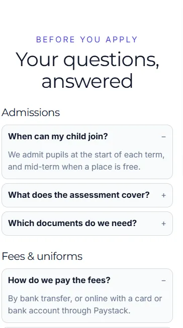

## "Now I want to change it"

Once it is on the page, a ready-made section is ordinary blocks. Click any word to change it, pick another photograph,
change a colour, a corner, a shadow or an effect, add a block or take one away. Nothing is locked.

It arrives with the space its design gives it, around the words and between the blocks. When you select it, that space is
drawn on the page with its size, and you can set it to anything on the scale, down to nothing.

A designed section also moves a little as a visitor scrolls to it, and its buttons answer the pointer and the keyboard. A
visitor whose phone or computer asks for less motion sees it still, all at once.

## "On a very wide screen, the welcome is taller than the window"

A welcome with a picture beside its words grows with the screen. On a very wide one — a monitor five thousand pixels
across — a picture half the page wide would be two thousand pixels tall, and the words beside it would sit below the
window. So every picture in a ready-made welcome is at most **three quarters of the screen's height** (`75svh`). On a
laptop or an ordinary desktop the picture is shorter than that anyway and keeps its own shape; the limit only does
something on a screen that is very wide for its height, or a phone held sideways. The picture is then cropped from the
centre, never squashed.

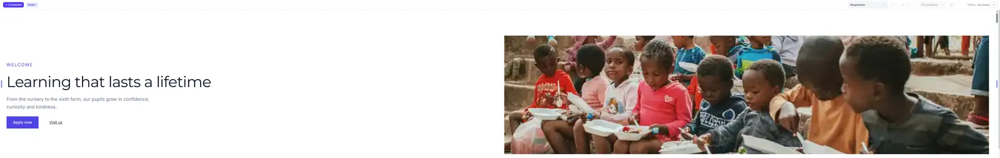

It is an ordinary **Max height** on the picture, so it is yours: select the picture and you will find `75svh` in the
Inspector under **Limits**. Type `50svh` for a shorter picture, a length such as `30rem`, or clear it to let the picture
keep its own shape however big the screen. **Ctrl+Z** undoes it. A Max height you type on any picture of your own works
the same way.

## "My sections look stacked on top of each other"

Every ready-made section brings its own room above and below, so two of them one under the other used to add up to a
very big gap. Two things now look after it.

**Sections of the same colour share their space.** Two plain sections, one under the other, have one space between
them, not two. Where the colour changes, the photo starts or a framed card begins, each keeps its own, because the
change of colour already shows where one ends. If you would rather each kept its own, turn off **Same-colour sections
share their space** in Page grid.

**One size for all of them.** Open **Page settings → Page grid…** (or right-click the empty page) and move **Space
above and below sections**. Every section of the site follows at once, on every screen; the header and the footer
keep theirs. **Back to the designs' own** puts each section's own design back in one step, and **Ctrl+Z** undoes
either. Tick **This page uses its own grid** first to give one page a different size.

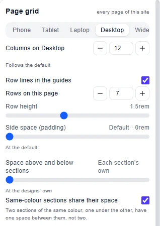

One section can still be different. Drag its top or bottom space on the page, or change it in the Inspector, and it
keeps its own; the side you did not touch stays where it was. The Inspector then says **Keeps its own space above and
below**, with **Follow the site** to bring it back in line.

## "I wrote my words, and now I want another look"

You added a welcome in **Calm**, typed your own title and put in a photo of your own pupils, and now the page wants to feel
bolder. Select the section and, in the Inspector, choose another **Finish**: **Bold**, any of the seven, or the
**Wireframe**. You can also press **Ctrl+Alt+F**, which moves to the next finish each time you press it.

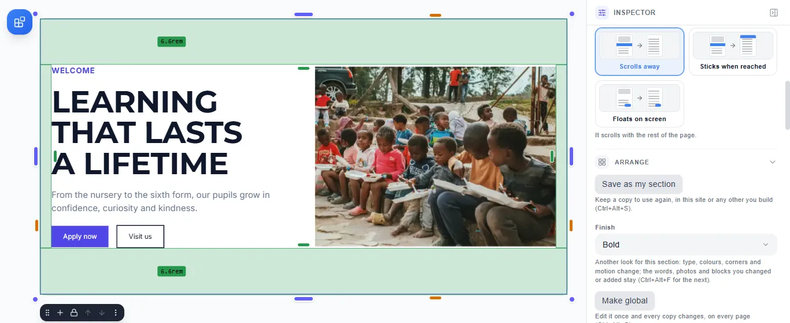

The look changes, as if you had added the section in that finish: the type, colours, corners, shadows and motion. **What you
made stays as you left it**: your words, your photos, your links and any block you added. What you never touched follows
the finish, so a section added as a Wireframe gets the designed words and photos when you give it a finish, and gets the
placeholders back if you choose the Wireframe again.

- A colour or shadow you added where the finish puts none, such as a background on a plain column, stays too.
- Over a photo of your own, the words stay white and the photo keeps its shade, even in the Wireframe.
- **Ctrl+Z** puts the whole section back in its old finish in one step.
- A global section changes on every page that has it.
- The Finish appears only for a ready-made section. A section you built from blocks is already your own design.

## "A new header for every page"

The **Headers** and **Footers** tiles work a little differently, because a site has one header and one footer, shown on
every page. Choosing one asks **"Replace the header on every page?"** **Replace** puts it on every page at once; **Cancel**
changes nothing; **Ctrl+Z** brings the old one back everywhere.

On a phone, a header's menu is one line that slides sideways, so every link can be reached and the header stays short.

## "I built a lovely band and want it again"

Select the section, then **Save as my section** in the Inspector (or press **Ctrl+Alt+S**) and give it a name. It appears in
the Sections tab under **My sections**, and it is there in every site you build. Adding it gives you a copy: changing the copy
on one page never changes the saved one or any other copy.

Under each of your sections are **Rename** and **Delete**. Deleting asks first, and pages that already use it keep their copy.

## "The admissions banner should be the same on every page"

Some sections should be the same wherever they appear, such as an admissions banner or a note about term dates. Select the
section and choose **Make global** in the Inspector (or press **Ctrl+Alt+G**), then give it a name.

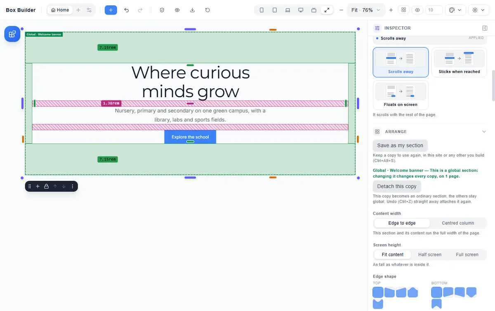

A global section is marked on the page by a green outline and the label **Global · its name**, and in **Layers** by a globe
and its name. Add it to other pages from **Global sections** in the Sections tab; a page can hold it more than once.

**Change it on any page and every copy changes, on every page.** The first time, a note says how many pages the change
reaches. **Ctrl+Z** undoes it everywhere at once.

- **Detach this copy** (in the Inspector) makes one copy ordinary, so you can change it on its own. Ctrl+Z straight after
  attaches it again.
- **Stop being global** (in Global sections) asks first, then leaves every copy where it is, as an ordinary section.

The published website is plain pages: nothing links the copies once the site is online.

## "A new page that looks like the others"

The **+** beside the page tabs opens **Add a page**. Type the page's name, then choose where it starts:

- **Blank page**: an empty page with your site's header and footer.
- **Duplicate**: a copy of the page you are on.
- **A page template**, drawn as it will look, in the wireframe or any finish: **School home**, **Landing page** or
  **Open day**. More templates arrive as more kinds of section are added.
- **My templates**: any page you have saved. In **Page settings**, **Save page as template** keeps the page you are on (up
  to 40), and **Rename** and **Delete** are under each one.

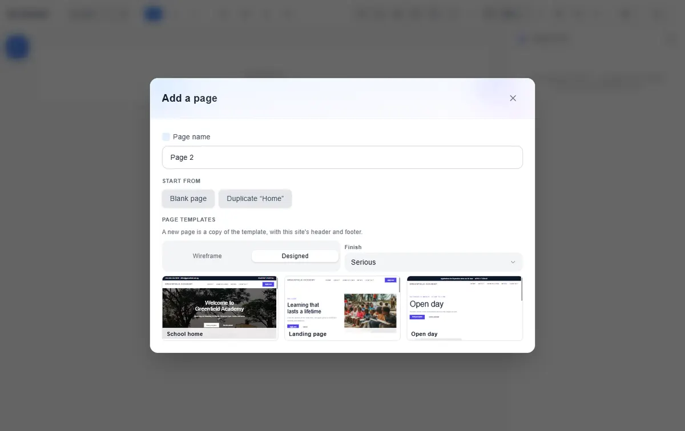

A page made from a template is a copy. It takes your site's own header and footer, so the new page belongs with the rest.

## Reference

| What | Where | Keys |
|---|---|---|
| The ready-made sections | Add panel → **Sections** | **B** opens the panel, **/** searches |
| Add a section | Click or tap a tile; **Enter** on a focused tile; drag a tile onto the page | **Ctrl+Z** undoes |
| Plain or finished | **Wireframe \| Designed** at the top of the tab | |
| The look | **Finish**: Serious · Minimalist · Plain · Bold · Calm · Startup · Playful | |
| The kinds of section | Headers · Hero / Welcome · Footers · Blank · Our story · Text · Features / Services · Spotlight / zig-zag · Stats · CTA / Banner · Cards · Programmes / Products · Gallery / Collage · Slideshow · Team · Testimonials · Logos / Clients · List · Contact details · Questions & answers · Fees table · Latest news | |
| On a phone | Pictures before their words in a zig-zag · cards one under another · numbers two by two · a button under its words · a gallery's big photo first · a slideshow one slide at a time | Nothing to set |
| A big photo or card in a grid | Select it → Inspector → **Columns wide** (and rows tall) | **Ctrl+Z** undoes |
| A slideshow | Select its slides' box → Inspector → **Show one at a time**: **Moving between them** (Dots · Arrows · Both · None) and **Move on its own every** (0 = only when a visitor moves it); a moving one has a Pause | Visitor: arrow keys, swipe |
| A welcome's picture on a very wide screen | At most 75 % of the screen's height, cropped; select the picture → Inspector → **Limits** → **Max height** (`75svh`) to change or clear it | **Ctrl+Z** undoes |
| The space between sections | **Page settings → Page grid…** → **Space above and below sections** (the site, or this page with its own grid); **Back to the designs' own** | **Ctrl+Z** undoes |
| Same-colour sections share their space | On at the start; switch it off in Page grid | |
| One section keeps its own space | Drag its top or bottom space on the page, or change it in the Inspector; **Follow the site** gives it back | **Ctrl+Z** undoes |
| Another look for a section on the page | Select it → Inspector → **Finish**: Wireframe or one of the seven | **Ctrl+Alt+F** next finish · **Ctrl+Z** undoes |
| Keep a section | Inspector → **Save as my section** | **Ctrl+Alt+S** |
| Your sections | Sections tab → **My sections**: add, **Rename**, **Delete** | |
| A section the same everywhere | Inspector → **Make global** | **Ctrl+Alt+G** |
| One copy on its own | Inspector → **Detach this copy** | **Ctrl+Z** re-attaches |
| No longer global | Sections tab → **Global sections** → **Stop being global** | |
| A new page | **+** beside the page tabs → **Add a page**, or **Add a page** at the top of the Sections tab | |
| Keep a page as a template | **Page settings** → **Save page as template** | |
| Questions and their answers | Select the questions → Inspector → each question's words and answer; add, move up or down, delete; **FAQ SEO markup** on | Visitor: **Tab**, **Enter** / **Space** opens |
| Which page the visitor is on | The menu marks it with a heavier underline, and tells a screen reader | |

Some sections stand in for a part the builder does not have yet: a form, a map, a strip of logos, a video. Their tiles say
**placeholder: form** (or map, table, logo strip, video, counter, lightbox, cart), and they are built from ordinary blocks until that part arrives.
