# Website Builder Guide

Build and maintain your school's public website by dragging blocks onto a page — no code. This is the same idea as Wix, Canva or WordPress's block editor, but tuned for a school and wired into Educo's themes and design system.

**Who it's for:** teachers and administrators who need to keep the school site up to date (term dates, news, staff, admissions) without waiting on a developer.

**Where it lives:** open the builder at `/website/box-demo`. Your work saves automatically to your browser as you go.

---

## 1. Your first win — put a welcome message on the homepage (2 minutes)

1. Open the builder. You start on a **blank page** called *Home*.
2. In the left **Blocks** panel, click **Heading**. Pick **Display** in the little style menu that appears.
3. The heading lands on the page and is selected. It reads *New heading* — click it and type **"Welcome to Riverside Primary"**.
4. Click **Text** in the Blocks panel → **Lead**. Type a sentence: *"A happy, curious place to learn — right in the heart of town."*
5. Click **Preview** (top bar) to see exactly what a visitor will see. Click **Exit preview** to return.

**You now have:** a headline and intro on your homepage, saved automatically. Everything below builds on this.

---

## 2. The workspace at a glance

| Area | What it does |
|------|--------------|
| **Blocks panel** | Everything you can add: Layout, Text, Media, and Components. Open it from the **Blocks** launcher at the canvas's top-left (or press **B**). On a laptop or larger it sits at the side and the page moves over to make room; on a tablet or phone (under 1024px) its **+** waits bottom-right and the blocks rise from the bottom in a sheet (on a tablet no wider than 32rem, centred). **Search** to filter, use the **category tabs** to jump, then click a block to add it (or drag it onto the page). Close it with the ✕, Esc or B (or a click outside it on a small screen). |
| **Canvas** (middle) | Your page. Click a block to select it; its controls appear on the right. |
| **Inspector** (right) | Every setting for the selected block, in three tabs: **Design**, **Content**, **Per‑device**. Collapse it (the collapse button in its header) to give the canvas more room, and reopen it from the slim rail on the right. Under 1024px it starts as that rail and slides over the page when opened. |
| **Top bar** | Pages, **Add a band**, Undo/Redo, **Preview**, **Export**, **Reset**, the device switcher, and **Base size** (the number box; the words "Base size" show beside it only on very wide screens). Under 1024px (a tablet or phone) it is one row (pages, Undo, Redo, Preview and **⋯ More**) and everything else is in **More**. |

[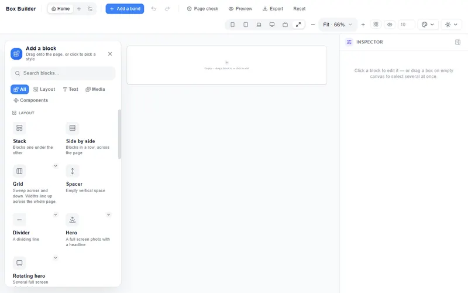](img/guide-blocks-panel.webp)

**Flow by default, float for free.** New blocks join the normal page flow (they stack and reflow responsively). When you want to place something freely on top, you switch a block to **Floating** — see §7.

---

## 3. The building blocks

### Layout

**Stack, Side by side and Grid are the same block in three arrangements.** You don't have to choose
correctly up front: select any of them and open the Design tab's **Arrange** section. **Direction**
(Top-to-bottom · Side-by-side) turns a Stack into a row and back, and **Arrange as** (Free arrange · Grid) makes
it a grid. A stack becomes a row becomes a grid with one click, and whatever is inside comes with it. They're named for what they do to the blocks you
put in them — down the page, across the page, or both at once.

Separately, the **+ Add a band** button at the top of the screen adds a *tinted, full-width, padded strip*
across the page — the visible "Admissions" bar sort of thing. That's a different result from the **Stack**
tile, which gives you a plain transparent box. (Both used to be called "Section", which is why this note
exists.)

| Block | Use it for |
|-------|-----------|
| **Stack** | Blocks one under the other, down the page. A plain box you fill with anything. |
| **Side by side** | Blocks in a row, across the page — they wrap onto the next line on small screens. |
| **Grid** | Across *and* down, picked the way you insert a table: sweep **how many across × how many down**. Uneven splits (sidebar, feature + two) sit underneath. Feature cards, staff photos, an article beside a sidebar. |
| **Spacer** | Adjustable vertical breathing room. |
| **Divider** | A dividing line (solid, dashed, dotted, thick). |
| **Hero** | One photograph filling the screen, with your headline over it. |
| **Rotating hero** | Several full‑screen photographs in turn, each with its own words. |

### Text
| Block | Use it for |
|-------|-----------|
| **Heading** | Titles. Styles: Display, Title, Subtitle, Eyebrow. |
| **Text** | Paragraphs. Styles: Body, Lead, Caption, Quote. |
| **Button** | A call to action with a link (a page or a web address). |
| **List** | Bulleted or numbered lists. |
| **Link** | Words that go to a page. |

### Media
**Image**, **Photo gallery**, **Slider**, **Video** (YouTube/Vimeo/MP4), **Icon** (searchable symbol), **Embed** (paste an iframe/HTML).

**Every picture keeps its shape while it loads.** A photo, a gallery's photos, a Card's picture, an Accordion's or an
Alert's thumbnail and a video all hold the box they will fill before a single byte has arrived, and a photo is cropped to
that box, never squashed — so on a slow phone connection the words do not jump as the pictures land.

**Every block publishes the box it is drawn in.** An Icon, a List and a Divider are exactly as big on the published page as in the editor, at every screen size — an icon 22px tall on a phone is 22px published, and a list keeps the same space under each item. They are never padded out to the minimum size an *empty* box is given so that you can grab it.

### Photo gallery — many photographs at once

The Image block adds **one** picture. **Photo gallery** adds a whole set in a single step, and it's the block to reach for when you're putting up sports day, the fete or an open day.

Blocks → **Photo gallery**. A short setup opens and asks four things:

| | |
|---|---|
| **Choose photos** | One file dialog, **as many photographs as you like** — pick the whole folder. Each appears as a thumbnail as it's added, and you can drop any of them before committing. |
| **How many across** | 2, 3, 4 or 6. These are the counts that divide the twelve exactly, so the row is always even. |
| **Row heights** | **Even** for tidy rows of equal height, or **Follow the picture** so photographs of different shapes stagger instead of being cropped. Each is a little picture with its name: *Even · Tidy rows* and *Follow the picture · Never cropped*. |
| **Space between** | Starts at a small gap (1rem); slide it to none if you want. Sweep it and watch the preview — whatever you choose is what arrives. |

[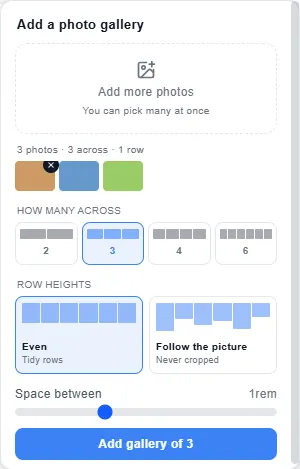](img/guide-gallery-setup.webp)

Then **Add gallery of 12** (or however many), and it lands.

**What lands is an ordinary grid.** That's deliberate and it's the whole point: each photograph sits in a real cell, so you can put a caption under one, give another a background, drag a cell's edge to make one picture wider than the rest, nest a whole layout inside one, or change the columns afterwards. Every control in §10c works on it, because it *is* one of those. A gallery isn't a special sealed block you can only fill with pictures.

**Descriptions start from your file names.** A file called `sports day 1.jpg` arrives described as "sports day 1" — a starting point to improve in the Content tab, not a caption the builder invented. Blank descriptions are the commonest accessibility miss on a school site, so it's better to start with something true.

> **Your photographs are resized as they come in.** A picture straight off a phone is around 1.2 MB, and a browser only keeps about 5 MB of your site — so a dozen of them at full size would not fit at all, and the page would quietly stop saving. Each one is stored with its longest edge at **1600 pixels**, which is larger than anywhere it's ever shown and far kinder to a parent loading the page on mobile data. If your browser's storage ever does fill up, the editor now tells you plainly instead of failing in silence — **export your site straight away** if you see that message.

### Show one at a time — sliders, and the rest

Any box can show its blocks **one at a time** instead of all at once. Select the box → **Design → Arrange** → tick **Show one at a time**.

Each block inside becomes a **page** that fills the box. Visitors swipe between them on a phone or a trackpad, and — once they've tabbed to it — move one page per arrow key. **None of that puts any code on your site.**

**Every page is an ordinary box**, and that's the whole point of doing it this way. One page can be a photograph, the next a headline over a photograph, the next a three-column layout with a button in it. Everything else in the Inspector still works inside a page, because a page *is* just a box.

| Control | What it does |
|---|---|
| **Moving between them** | **Dots** (the default), **Arrows**, **Both**, or **None** — leave it on None and visitors swipe or use the keyboard. |
| **Move on its own every** | Starts at **off**. Slide it right and it advances by itself. |

Three things happen automatically and are worth knowing:

- **The dots are real links.** Each page has its own address, so you can link straight to one from anywhere else on your site. If you give a page a **Bookmark** in the Content tab, that's the address used.
- **It holds still while somebody's reading it.** If it moves on its own, hovering it or tabbing into it stops it until they leave. Something that keeps moving while you're trying to read it isn't just annoying — it's an accessibility failure.
- **A visitor who's asked their device for less motion never sees it move**, and the sliding isn't animated for them either.

> **Nothing is added to your site unless it's needed.** Set *Moving between them* to **None** with no auto-advance and the published page contains **no JavaScript at all** — it's pure CSS. Dots or auto-advance add one small script.

### Slider, Hero and Rotating hero

Three tiles that set all of the above up for you, so you don't have to know the mode exists.

| Tile | Where | What you get |
|---|---|---|
| **Slider** | Media | Your photographs, one at a time, with dots. Choose them in one dialog, pick how visitors move between them, and whether it advances on its own. |
| **Hero** | Layout | One photograph filling the screen with your headline over it. |
| **Rotating hero** | Layout | Several of those in turn — each page its own full screen, its own photograph, its own words. |

**Your words stay readable whatever photograph you choose.** A hero lays a dark wash over the picture before the headline goes on top. That isn't decoration: white text on a bright photograph is unreadable, and you pick the photograph, not us. The wash is strong enough that white text clears the WCAG AA contrast bar **even over a pure white photograph** — and it's an ordinary Background overlay, so you can change or remove it with the control that's already there.

Everything the tiles make is ordinary blocks. Edit the second hero's headline by clicking it on the canvas; add a button to one slide and not the others; drag a slide's edge. There's nothing to convert and nothing special about them.

**Photographs** — select an Image block and open the **Content** tab:

- **Describe this image** — what the picture shows, read aloud to visitors who cannot see it and used by search engines. Leave it blank only when the picture is purely decorative (a divider, a texture).
- **Load straight away** — off by default, which is right for anything below the fold. Turn it on for a picture at the very top of the page, or the top of the page opens briefly empty.
- **Show the whole picture (don't crop it)** — appears once you have uploaded a photograph, because the builder then knows what shape it is. Ticked, the block takes the photograph's own proportions; unticked, it is cropped to the **Height** you set in the Design tab. Cropping is often what you want for a neat row of equal cards — this is the choice, not an accident.

The builder measures a photograph when you upload it and tells the browser its size up front, so **the space is reserved before the picture arrives**. Without that, text jumps down the page as each photo loads and readers lose their place — the single most irritating thing a photo-heavy site can do.

> **Your photograph arrives at its own shape now, whichever way you added it.** Until recently an Image block
> came with a fixed height already on it, so a tall or square picture added *from the Blocks panel* was
> cropped to a letterbox — while the same picture *dragged* onto the page came out correctly. Two routes, two
> results, and the common one was wrong. A picture's shape is now taken from the picture; a height you set
> yourself still crops, exactly as before.

### Components (design‑system pieces)
These are ready‑made, themed pieces. **Each one is a fully editable tree** — click any inner part (a card's title, its button, a rating's star) and you get that part's full controls.

| Component | What it is |
|-----------|-----------|
| **Accordion** | Expandable Q&A / FAQ. **29 designs** plus six settings that combine with any of them; edit each item inline. |
| **Alert** | One message that matters — closure notice, open day, fees deadline. **23 designs**, six severities, four forms (inline · banner · callout · toast), and up to two action buttons. |
| **Card** | Image + heading + text + button — the classic content card. |
| **Quote** | A testimonial with an author line. |
| **Stat** | A big number + label (e.g. "1,000+ Happy families"). |
| **Badge** | A small pill label (e.g. "New", "Open day"). |
| **Rating** | A row of stars. |

> **Tip:** a component "is its own box" — there's no extra wrapper around it. Click straight into any inner piece to style it.

---

## 4. Business scenarios (follow along)

### Scenario A — Publish the term dates as an FAQ
**Goal:** parents can quickly find term dates and key info.
1. Blocks → **Accordion**. It arrives with three starter Q&A items.
2. On the canvas, click the first question and type *"When does the Autumn term start?"*; click its answer and type the date.
3. In the **inspector → Content**, click **Add item** for each extra question; reorder with the ↑ / ↓ arrows; tick **Open by default** on the most important one.
4. Still in the **Content** tab, pick one of the 29 designs that matches your site, and combine it with the six fine-tuning settings.
5. **Preview** → click a question; it expands. Done.

### Scenario B — A "Why choose us" strip of three cards
**Goal:** three selling points with icons and a link each.
1. Blocks → **Grid** → **3 across**.
2. Into each column, add a **Card**.
3. Click each card's **heading** and type the point ("Small classes"); click the **body** and describe it; click the **button** and set its **Link** to the relevant page.
4. Want the heading centred? Select just that heading → **Content position** or **Text align** → centre. Only that heading changes.

### Scenario C — An eye‑catching admissions banner
**Goal:** a coloured band with a headline and an "Apply now" button.
1. Blocks → **Stack**. In the inspector give it a **Background** colour (or image) and some **Inner spacing**.
2. Drag a **Heading** ("Admissions open for September") and a **Button** ("Apply now") onto the Stack — or select the Stack and use **+ Add a block inside** on its toolbar. (Clicking a tile adds the block *after* the selected one, not inside it.)
3. Select the button → set its **Link** to your application page, tick **Open in a new tab** if it's external.

### Scenario D — Show off results with a Stat and a Rating
1. Blocks → **Stat**. Click the big number, type "98%"; click the label, type "pass rate".
2. Blocks → **Rating**. Recolour or resize any single star by clicking it.

---

## 5. Editing a block — the Inspector

Select any block and its settings appear on the right, in three tabs.

### Design tab
- **Placement** — *In the layout* vs *Floating*, **Lock position & size**, and (when floating) **Front/back order**. See §7.
- **Size** — **Width** (Fit = hug the content, Full = fill the row, Custom = a % or a size — type "240px" and it is kept as 15rem, so it grows with a reader's text size), **Position in row** (Left / Centre / Right / Spread — for the screen you are editing only), **Content position** (a 3×3 grid — where the content sits inside the block when it's bigger than its content), **Height**, and **Trim to size**.
- **Spacing** — **Inner spacing** (padding, inside the block) and **Outer spacing** (margin, around it).
- **Outline & effects** — rounded corners (all or per‑corner), border, shadow, tilt, **See-through** (below).
- **Background** — a colour (with a full OKLCH picker, eyedropper, and *None* for transparent) or a background image.
- **Text style (everything inside)** — on a box (a Stack, a row or a grid): font, size, colour, line spacing and more, cascading to everything in it (see §10d). A single text block's own **Text style** is on the Content tab.

#### See-through — the box fades, not what's in it

Set **See-through** on a section, a grid or a cell and the page shows through **that box** — its background, its border. Everything inside it stays exactly as solid as it was: the cards, the headings, the photographs.

That holds at every depth. A cell inside a see-through grid is solid; a heading inside that cell is solid. Make one cell see-through on its own and only that cell fades — its own contents are protected in just the same way.

When you *do* want the whole thing to fade together, tick **Fade what's inside too**. It appears as soon as you set a See-through value, and applies from that box down and nowhere else.

It works for a **background image** too, not just a colour: fade a photo hero and the photo softens while the headline and button on top of it stay perfectly crisp.

> **Why this needs saying:** in CSS, fading an element fades everything inside it, and there is no setting a child can use to escape. So "make this box see-through" is applied to the box's own paint instead — alpha in the colour, and for a photograph a layer of its own behind the content. Your contents keep their real colours, and the published page does exactly what the canvas showed you.

### Content tab
The content that changes per block type — a Button's text + link, a Text's copy, a List's items, an Accordion's items, an Image's source, a Card's title/body/button, and so on.

- **Text style** — for a text block: font, size, weight, capitals, line and letter spacing. On a component the same controls are under **Typography**.
- **Advanced CSS** — extra CSS declarations for power users, on every block (safely sanitised). Like any style it belongs to the screen you are editing: type it with **Mobile** selected and only phones get it. Two kinds of motion are refused, and the field **says so** under it ("Not applied: …"): animating the size or the place of a block (`transition: height`, `width`, `top`, `margin`, `padding`… — it makes the page jerk on a phone; animate `transform` or `opacity` instead), and an animation that runs forever (`infinite` — a visitor must be able to make moving things stop).

### Per‑device tab
A note saying which screen you are editing, and one checkbox: **Hidden everywhere** (at **Desktop** or **Full width**) or **Hidden on** that screen (at any other chip). To change how a block looks on one screen, pick that screen's chip in the top bar and edit in the Design tab (see §8).

**The yellow note says exactly what changes, and where.** Pick any chip but Desktop and the Inspector opens with a note
like *"Editing Tablet portrait — what you change here (size, spacing, colours, fonts, backgrounds) shows on tablets held
upright — and on phones too, unless you change it there."* Every look you set there is that screen's own — a colour, a
text size, a Button's paint — and the published page shows it on those screens, as the canvas does. The words, links,
pictures and effects (hover, entrance, what a pinned bar does as it takes hold) stay the same on every screen, and the
note says so; an effect's own panel says *"Applies to every screen"* while you edit a smaller one.

[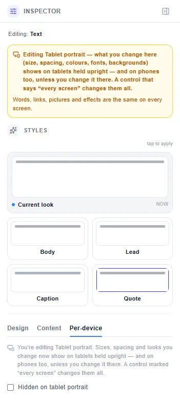](img/guide-per-device-banner.webp)

> **Rule of thumb:** *Design* = how it looks; *Content* = what it says; *Per‑device* = whether it shows on each screen. (How it *looks* on a phone is set in Design, with the phone's chip picked.)

---

## 6. Sizing, hugging and positioning content

- **Words, buttons and small things hug their content.** A short heading, a button, a link, a Stat, a Badge or a Rating is exactly as wide (and tall) as its content — no empty box stretched around it, whether the block sits in the layout or floats freely.
- **Components and columns use the page's width.** An Accordion, an Alert, a Card or a Quote fills the line it is dropped on, so an FAQ is as wide as the page instead of hugging its questions. Columns you dropped side by side and never resized take what is left of their line: when a screen is too narrow for both and one moves down, it fills the line it moves to, and when you delete one of three, the other two close the gap. A width you set yourself — by dragging an edge, or with **Custom** — is always kept, and a space you open by dragging the outer edge of a line stays where you made it. Switch **Width** to **Fit** to make a component hug, **Full** to fill the row, or **Custom** for an exact size.
- **A resized block is exactly the size you set.** Drag an edge or type a Width/Height and the block occupies precisely that — the box *is* the space it takes, never a larger invisible wrapper.
- **Resize from any edge.** Drag any edge or corner handle. The grabbed edge moves; the opposite edge stays put. You can grow a block from the **top** edge too.
- **Stays put while scrolling.** Select any block that sits in the layout — a section, a stack, a grid, a heading, a button, an image or a component — then **Design** → **Placement** → *Stays put while scrolling*. Each way is shown as a small picture of the page before and after a scroll. Two ways, and they're genuinely different:
  - **Sticks when reached** — it scrolls with the page until it reaches the top of the window, then holds there. It keeps its own place in the layout, so it hides nothing until you scroll. Right for a header, and for a **side rail**: pin a narrow column beside taller content and it follows the reader down. Held against **Top** or **Bottom**.
  - **Floats on screen** — it is lifted off the page and always visible at the edge or corner you pick, from the moment the page opens. Nothing keeps its space, so the page runs underneath it. Right for a cookie bar, a back-to-top button or a chat bubble. Held against any **edge** or any **corner**.
  The line under the control tells you **where this block lets go**: a block placed straight on the page holds *for the rest of the page*; one inside a Stack, a Grid or a row of blocks names what it leaves with. A bar that **floats** against the top or bottom also says what it covers — the top of your page, or your footer — and offers **Keep its space instead**, which switches it to the way that keeps its place.
  **A block you placed freely can hold on screen too.** Float a stack, drag it where you want it, then choose **Floats on screen** — it holds exactly there, however far the page scrolls, and it doesn't jump when you choose it. *Sticks when reached* isn't offered for a floating block and the Inspector says why: that one holds a block against the place it occupies in the page, and a freely placed block has given that place up. Put it back **In the layout** to use it.
  **When it takes hold.** Once a block is pinned you can choose what it *becomes* as the page moves under it — each shown as a picture of the bar before and after a scroll: **Shadow** (lifts off the page), **Solid** (a see-through bar fills in), **Glass** (frosted, with the page showing through), **Rule** (a hairline underneath) or **Condense** (it gets shorter). **Nothing** is the default. *Takes hold over* sets how much scrolling it takes, 120px by default. Condense needs something to condense — a height or inner spacing of its own — and the Inspector says so when there is none. It shortens from the side where there is room — below blocks that sit at the top, above blocks at the bottom, from both ends when they are centred — so the bar's own words and links stay in view, and nothing below it moves. A reader who prefers reduced motion simply sees the resting look; the block is still pinned.
  **Two bars at the same edge sit under one another.** Set a second block to **Floats on screen** at the same
  edge and it lands *below* the first, not on top of it — a header and an announcement bar, or a cookie notice
  and a back-to-top button. Each keeps its own height, and the one nearest the edge is the first of them down
  the page (at the bottom, the last). It used to be that three bands all set to stay on screen pinned to the
  same place and covered each other, so two of the three were simply invisible — each doing exactly what it was
  told. The page now measures how much bar is already there, so they queue instead.

  **And it works for *Sticks when reached* too**, with one sensible difference: those bars queue only behind
  bars they can actually meet. Two of them **in the same box** — side by side in a Stack, or a header and an
  announcement bar both dropped on the page — do cover each other, so they queue. Two in **different sections**
  never share a screen at all: the first lets go exactly as the second arrives, so neither is moved. Nothing is
  shifted to avoid a collision that cannot happen.

  Both take a *distance from the edge*, and both are **per device**: to turn pinning off for phones, pick the **Mobile** chip and set **Stays put while scrolling** to **Scrolls away** (Design → Placement) — it stays off there, on every reload. If something is stopping it working, the Inspector says so and **names the block**: a block that clips its contents (which includes simply having rounded corners) stops anything inside from holding its place, and a block that's been **tilted** — or a component, or the glass Alert — makes its own frame, so anything fixed inside holds against that instead of the window.
- **The handles stay on the block, all the way.** However far you drag, the eight handles and the little toolbar ride with the edge you're moving — they never come adrift and leave you dragging a block whose handles are sitting somewhere else on the page.
- **The top and bottom edges don't move each other.** Drag the bottom and the top stays put; drag the top and the bottom stays put. Where there's nothing left to give — a block already at the very top of the page, or a row above that has run out of room — the edge simply stops. It never grows out of the far side to make up for it.
- **Two blocks that touch share the boundary between them.** Drag the **top** edge of a block and the block above gives back — or takes up — exactly what you gave, so the two stay flush and **no white space is ever left between them**. Shorten the last stack on a page and the one above it grows to meet it, by itself. It works the same whether the two are in one band or each in its own. If the block above is already only as tall as what's inside it, there's nothing to give and the edge stops there. This is the vertical version of how a grid cell's edge already behaves — the boundary belongs to both blocks, not to whichever one you happen to be holding.
- **A slider always shows you the real number.** If a block has ended up taller than the height slider's own range — easily done by dragging its bottom edge down a few times — the slider stretches to reach it instead of parking at the end and pretending. That matters because the handle sitting at the far right used to look identical whether the block was 45rem or 115rem, and nudging it would have silently snapped the real height down.
- **A boundary that meets several stacks moves all of them.** Two stacks side by side aren't separate as far as an edge is concerned — they share the band they sit in, and the band is what the edge below them belongs to. So dragging that edge moves the band, both stacks, *and* the rows inside either of them. Nothing is left hanging: you won't get the boundary closing neatly on one side while a gap opens under the last row of the column next to it. There's no grouping to switch on — putting two stacks on the same line is what groups them.
- **A stack next to another still has whatever is above it.** A stack with a neighbour beside it behaves exactly like one on its own: drag its **top** edge up and the band above gives way, its neighbour comes along, and it stays inside its own band. It never lifts out and floats over the header above it.
- **Space you deliberately left is spent first, and never thrown away.** If you've given a block outer spacing above it, dragging its top edge *up* closes that space before it takes anything from the block above — free space costs the neighbour nothing. Dragging *down* hands the room to the block above and leaves your spacing exactly as you set it.
- **A block you drop takes the room it lands in.** Drop a Stack into a section or a grid cell that has height to spare and it fills it, rather than sitting as a small sliver with the rest of the space empty underneath. Where there's no room to take — a grid nobody has given a height to — it arrives at a comfortable default size instead. A height **you** set is never overruled by either.
- **A resized block is one shape.** When you make a button, card, badge or any block bigger, the block *itself* grows to fill the new size — there's never a second empty shape left behind at the old size. Its content re‑positions inside it automatically (a resized button centres its label).
- **Content position.** When a block is bigger than its content (e.g. you made a badge tall), use the **3×3 Content position** grid to place the content — top‑left, centre, bottom‑right, etc. Works for every block that is not a container (Stack, row or grid), elements and components alike.
- **Position in row.** To left/centre/right‑align a hugging block within its row, use **Position in row**. **Spread** shares the
  row out: the first block at the left edge, the last at the right edge, the rest evenly between. It applies to the screen you are
  editing, so a block can sit on the right on a phone and on the left on a desktop.
- **Every screen, or just this one?** With any chip other than Desktop or Full width selected, a change applies to that screen, not the base design (§8 says which others it reaches) — except a few controls
  that change the page's structure (**Floating**, its **front / back order**, a section's **Content width**). Those say *"Applies to
  every screen"* while you are editing a smaller screen.
- **Line up** on a box names the direction it moves: *across* in a top-to-bottom stack, *down* in a side-by-side row or a grid. In a row or a grid it also offers **Text lines up** (see *Lining blocks up*).
- **A page header or footer spreads by itself.** Give a block the meaning **Page header** (or **Page footer**) and its
  line of two or more blocks is set to **Spread** and centred on one line — the logo at the left edge, the menu between,
  the button at the right edge — so a wide screen is never left empty on the right. It is an ordinary setting: pick
  **Left** in **Position in row** and it stays where you put it. Lines you aligned yourself are never changed.
- **A block you add is always big enough to see.** An empty block has nothing inside to hold it open, so it takes a small minimum size until you put something in it or size it yourself. This matters most when you add several blocks into a stack you have already given a height to: they no longer share that height until each one is a sliver — the stack grows a little instead, and every block stays large enough to click and to drag by its handles. A size **you** set is always honoured, however small; the minimum only applies where you have not said.

---

## 7. Free placement — Floating, Grouping and Locking

Sometimes you want to place things freely (overlap a badge on an image, arrange a little cluster).

- **Float a block:** select it → **Placement → Floating** (or **Alt+F**). Now drag it anywhere; arrow keys nudge it. On phones a floating block automatically drops back into a clean stack, so your layout never breaks.
- **Floating a box takes its contents with it.** Float a grid and every cell goes too, keeping the arrangement it already had — you are moving the whole thing, not scattering it. None of the children become floating in their own right, so they still behave as a grid inside their new position.
- **Returning it puts everything back.** Switch a floated box back to *In the layout* and it lands exactly where it started, cells and all — and nothing else on the page is altered, including the height you set on the section around it. Floating and returning is a round trip, never an edit.
- **Or float just one piece.** Float a single cell and only that cell leaves the flow; its siblings and the grid around them do not move.
- **Group blocks (like slides):** marquee‑select several blocks (drag a box around them on empty canvas), then **Group these N** (or **Ctrl+G**). The group moves and locks as one unit; its contents still reflow responsively. **Ungroup** with **Ctrl+Shift+G** or the block's ⋮ **Block actions** menu.
- **Lock position & size:** select a block → **Lock position & size** (or **Ctrl+L**). It can't be moved or resized by accident, but its content and colours stay editable. Unlock the same way.
- **Copy, paste & place a whole group:** select a group and **Ctrl+C**, then **Ctrl+V**. The whole group copies as one unit — every component inside it, with fresh identities (the copy is independent of the original). A **floating** block or group pastes **slightly offset** so it doesn't hide the original, stays **floating and selected**, so you can immediately **drag it or arrow‑nudge it** into the exact position you want. A block that sits **in the layout** is pasted straight after the selected block — or inside it, if the selected block is a container.

> Newly‑added and pasted blocks are **auto‑selected**, so a copy dropped behind a floating one is never "lost".

---

## 8. Making it look right on every device

The builder is responsive by design, and you can fine‑tune per size.

1. Use the **device switcher** (top‑right) to view **Mobile (375)**, **Tablet (768)**, **Laptop (1024)**, **Desktop (1280)**, **Wide (1920)** or **Full width**.
2. At **Desktop** or **Full width** you edit the base design. At **Mobile**, **Tablet** or **Laptop** your edit applies to that screen and the narrower ones. **Wide** branches off: what you set there stays on big screens and reaches no other. That holds for every look — sizes, spacing, colours, fonts, backgrounds — on the canvas *and* on the published page; the words, links, pictures and effects are shared by every screen.
3. On a narrow screen a row stays side by side while every block's words keep about 14rem and, on a phone, every block keeps at least 10rem of the page's columns; when they would not, it stacks. A block left alone on its line takes the whole line on a phone. Nothing forces a horizontal scrollbar. (Pages saved before 4 October 2026 always stack on a phone.)

The full list of chips, and which controls change per screen, is in the reference: [How controls change per screen](./layout-reference.md#how-controls-change-per-screen). How a row behaves on a phone is told in [the story, §2](./layout-story.md#2-i-want-a-photo-beside-my-words) and [§3](./layout-story.md#3-three-cards-across-that-stack-on-a-phone).

**Base size** (top bar) sets the rem base everything scales from — bump it up and the whole page scales proportionally while staying readable.

### Everything scales with the screen — except below what can be read

Your text, your spacing and your pictures all follow the width of the screen, so a page looks deliberate on
a phone and on a 27‑inch monitor rather than being the same layout squeezed. Text grows from **16px** on a
phone to about **22px** on a large desktop, and every other size — headings, buttons, captions — is a
proportion of that one value, so they scale together and keep their relationship to each other.

> **16px is a floor, not a size.** Spacing *should* close up on a narrow screen; text should not, and for a
> while it did — body copy came out at **11.2px on every phone** and a button label at under 10px, because
> the reading size was following the same unit as the gaps. It now stops at `1rem` and grows from there.
> That floor is in `rem`, so a reader who has set a larger text size in their own browser still gets it.

**A photograph keeps its own proportions at every width.** A 4:3 picture is 4:3 on a 320px phone and on a 4K
monitor — only its size changes — and it never runs off the side of the screen. If you want it cropped to a
shape of your own, set a **Height** and that is what you get.

**The builder's own toolbar follows the same rule.** Narrow the window and the top bar **wraps onto more
rows** rather than pushing Preview, Export and the device chips off the side. Every control stays on the
screen at any width. On a desktop it is a single row: below 1,600px wide, **Add a band**, **Page check**,
**Preview**, **Export** and **Reset** show only their icons. Point at one to see its name; a screen reader
reads it the same as before. On a touch screen every button is 44px for a finger, so the bar needs a little more
room: one row from 1,366px wide, two rows at 1,280px, and the buttons' words appear from 1,800px. Under 600px — a phone — the bar is one row of Pages, Undo, Redo, Preview and More, and everything else is in More.

---

## 9. Themes, colours and accessibility

**Two independent themes — pick each freely:**
- **Website theme** (top bar, the 🎨 *Purple Dream / Light / Dark / Midnight* picker) — the theme of the **site you're building**. It re‑skins the **canvas, all its content, and the export** so you can design, say, a Purple site. It's **saved with your site**.
- **Editor theme** (the sun/moon picker beside it) — how the **builder UI itself** looks while you work. It never changes your website; design a Light site in a Dark editor if you like.

- Colours come from the site's **design tokens** (an OKLCH colour system) — pick from themed swatches, a spectrum, a hex field, or the eyedropper. There are **no hardcoded colours**, so switching the Website theme re‑skins everything consistently.
- **Any colour can be see-through.** The palette's **Opacity** slider (0–100%) sets it, and the hex field takes `#rrggbbaa` or `rgba(…)` as typed. A swatch picked for a see-through colour keeps its transparency — so **Tint over background** stays a tint and the photo shows through it.
- Colour fields show a **WCAG contrast** readout so text stays legible.
- **Text follows the page, space follows the box.** A heading is one size wherever it sits — in a sidebar, a card or a
  wide band — so the page's hierarchy holds; a card's padding still tightens in a narrow column. (Decided 2026‑09‑28.)
- **Links read on every Website theme.** A link's colour is your brand colour, moved lighter or darker only as far as it needs to read (4.5:1) on that theme's page and on a card — on Light the brand is used as it is; on Dark, Midnight and Purple it is lifted so a menu is legible. A link inside a coloured band takes the band's own link colour instead.
- Every control is keyboard‑accessible and labelled.

---

## 10. Multiple pages, Preview and Export

[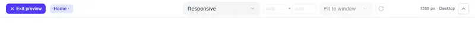](img/guide-preview-bar.webp)

- **Pages:** use the Pages control (top‑left) to add pages, rename them, set the **Home** page, duplicate, and put them in order with **Move earlier** / **Move later** (the order of the page tabs and of the Preview's page menu). Buttons can **link to a page** so your nav works.
- **Preview:** a true, isolated preview of the exported site — **one real page at a time**, not every page stacked together. Switch devices inside preview, and click your own nav to walk from page to page exactly as a visitor will.
- **It opens at the size of your own screen.** The page fills your whole window — the same width *and* height a visitor on your monitor gets — with no frame, no padding and no rounded corners around it. The bar floats *over* the page rather than sitting above it, so it costs the preview no height.
- **The controls step aside when you say so — never on their own.** Press the hide arrow at the right end of the bar (or **H**) and the bar slides away for an unobstructed look; a small **Controls** button waits in the bottom‑right corner beside **Exit preview** to bring it back — down there, rather than at the top, so it never sits on the header and menu you built — and **H** works from anywhere, including after you've clicked the page you're previewing. The bar used to hide itself on a timer and again whenever the pointer left it — which meant choosing a device made the whole strip vanish before you could rotate it. It doesn't do that any more.
- **On a tablet or a phone the bar folds onto more rows** instead of running off the edge of the screen — every control, and the tab for each of your pages, stays on screen and in reach. On a laptop or a desktop it is one row.
- **Pick a device to see one.** A phone or tablet from the menu is shown at its real size, framed like a device sitting on a surface — which is right for a device and wrong for "show me my site".
- **Sweep the width to find your breakpoints.** Drag **either edge** of the preview: the page narrows from both sides and stays centred, and the readout names the width and the rung it lands on — *1024 px · Tablet landscape*. Keep going and you can walk it down to a phone. Double‑click an edge to get the whole window back.
- **Pick a screen by name.** The preview bar works like a browser's device mode. The **size** menu lists this site's own five screen sizes (Mobile, Tablet, Laptop, Desktop, Wide) and then **over sixty real devices**, grouped: iPhone · Android phones · Foldables · Tablets · Laptops · Monitors — each at its true size, named with its generation and its dimensions (*iPhone SE (3rd gen) — 375 × 667*). **Responsive** just fills the window.
- **Width and height are both real, and both editable.** Type any numbers you like into the two boxes and the page is laid out at exactly that; the menu then says *Custom*. Height matters as much as width — a hero built to be "one screen tall" is a different thing on a 667px iPhone SE than on a 1080px desktop.
- **Rotate** turns the screen on its side. Rotating back lands on precisely the numbers you started from.
- **Zoom** is yours: *Fit to window* shrinks a big screen until it fits, or pick 50–200% and it's obeyed exactly. Zoom past the window and the preview scrolls — every part of the page stays reachable.
- **A band you coloured and left empty is the same size on the page as on the canvas.** An empty band — including one holding a box or a grid you haven't filled yet — keeps its visible height when published, so a coloured strip at the top of your page is still there when a visitor arrives. A height you set yourself always wins over that, and a band with something in it takes its height from the content as usual.
- **A page shorter than the screen still ends with its footer at the bottom of the screen.** When a page ends with a **Page footer** and its content doesn't fill a visitor's window, the footer sits on the bottom edge of the screen — on every phone, tablet and monitor — and the spare room is above it, in the page's own colour. Nothing is stretched: the footer keeps its own height, and on a page taller than the screen nothing changes at all. If you gave the footer a top space of your own, yours is kept. A page with no footer is left exactly as you built it, and below its content you see your page's own background.
- **The one known difference from the canvas — a desktop scrollbar.** On a desktop browser that shows a classic scrollbar, the Preview's page is about 15px narrower than the canvas, so a block's share of the width can differ by up to about **0.4%**. That is expected and accepted; our checks allow up to **0.6%** for it. Anything larger between the canvas and the Preview is a bug — please report it.
- **Previewing changes nothing.** Choosing a screen to look at doesn't touch your canvas or which per‑device layer you're editing; that stays with the editor's own device switcher in the top bar. Looking is not editing.
- **The size you pick is the size the page really gets.** Choose *Wide* and the page is laid out at a genuine 1920 × 1080, so it picks the layout a 1920px screen gets — even when your own screen is smaller. It's scaled down to fit and the bar states both numbers (e.g. `1920 px · 73%`). It's never cut off, and never quietly re-laid out at your screen's size instead.
- **Nothing is added on top of your page.** The preview shows what you designed and only that. Earlier versions prepended a navigation bar of their own; it's gone, from the preview *and* the exported site. To let visitors move between pages, build your own header and set a block's link to **another page** — it resolves to the right file when you export. While you're in the preview, the page tabs in the toolbar walk you around the site without touching the design.
- **Export:** downloads your site as a **ZIP of real pages** — `index.html` for the home page and one `.html` per page, a shared `styles.css` (each page also carries its own few styles inside it), and two folders: `fonts/` for your typefaces and `images/` for your photos.

### One header and one footer for every page

A school site has many pages and one top and one bottom. Build the header once — your name, your logo, your menu — and it is
the header of **every** page.

1. Build the header on any page: a **Side by side** with your name and a few **Link** blocks, each set to **Link to page**.
2. Select it and, under **Design → Meaning**, set **What is this block?** to **Page header**. **On every page** is ticked for you.
3. Every page now starts with that header — the ones you have and every page you add or duplicate later.

[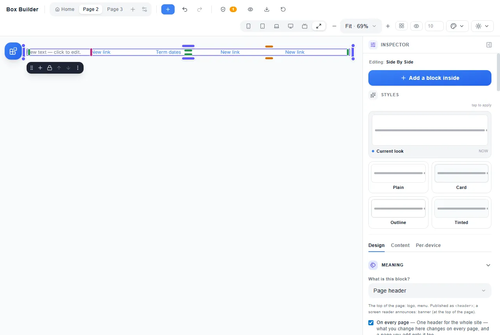](img/guide-shared-header.webp)

Change a word in the menu on *any* page and it changes on all of them; the menu is written once. A **Page footer** works the
same way. What you see on the canvas is what visitors get in the Preview, in the downloaded site and in the Educo app.

- **Delete it** on one page and it goes from every page — **Ctrl+Z** brings it back on all of them.
- **Untick "On every page"** and every page keeps its own copy, to change on its own. Tick it again on a page and *that*
  page's header becomes the one on every page (it takes the place of the others' own).
- **Hide it on a phone** (Per‑device → Hidden on mobile) and it is hidden on phones on every page.
- **A block added at the end of a page goes above the footer**, and one added at the start below the header — "End",
  "+ Add section", a click on a tile with nothing selected, and a paste all keep the header and footer where they belong.
- **A link to a page you deleted** is listed by the **Page check** ("goes to a page that was deleted") with **Show me**,
  so a menu never sends visitors nowhere.

[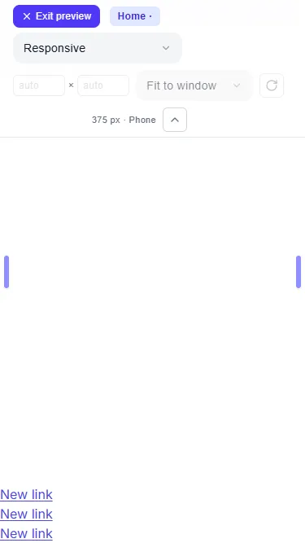](img/guide-footer-bottom.webp)

### A header that does more than sit at the top

Make the header stay on screen first (**Design → Placement → Sticks when reached**). Then:

| You want | Where | What a visitor sees |
|---|---|---|
| The header out of the way while reading | **When you scroll down → Slides away** or **Fades out** | Scrolling down, it slides off (or fades); scrolling up — or moving into it with the keyboard, or reaching the end of the page — brings it straight back. With "reduce motion" on, it goes and comes without moving. |
| The header lying over the first photo | **Over the first section** (a Page header) | The first section starts at the very top, its background running under the header; its words start below the header, so nothing is printed over them. Ticking it sets **When it takes hold → Solid**, so the header fills in once it is held. |
| A top bar that scrolls away, the menu that stays | **Keep only the last row on screen** (a Page header made as a **Stack** of rows) | The rows above the last scroll away; the last row — your menu — stays held at the top. |
| An announcement on every page | **Meaning → Add an announcement bar** (a Page header) | A bar becomes the header's first row — on every page, read out as a status, and a visitor who closes it does not see it again on the other pages. In a Side by side header it gets a row of its own above your name and links. |
| No header on one page (a landing page) | **Page settings → Show the header on this page** (and the footer) | That page has none; every other page keeps it, and any change made meanwhile is there when you tick it again. |

[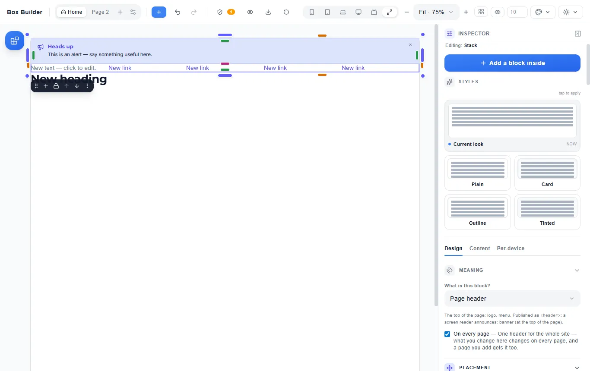](img/guide-announcement-bar.webp)

**Never more than a quarter of the screen.** If the bars held on screen — a held header, a held bottom bar — cover more than a
quarter of a phone held upright or on its side, the **Page check** says so, names them, and **Show me** selects one. Let a row
scroll away, make the header slide away, or make the bars shorter.

**Nothing goes above the header or below the footer by accident.** "Before" on the header puts the new block just under it;
"After" on the footer, just above it — the header and footer stay the page's, and stay shared.

### Widths: a column that stays its width, and one width for the whole site

**A column of a set width.** Select the block — a sidebar, a logo, a photo — and set **Design → Size → Width → Custom** to a
width such as `20rem` (a `%` is a share of the row instead). Beside it, the other blocks of the row share what is left, in
the proportions they already had: a ½ and a ¼ next to a 20rem sidebar take two parts and one part of the rest. The set
width grows with a visitor's text size, so it stays right for someone who has made their text bigger. Where the row no
longer fits side by side, the blocks stack, each the full width — nothing ever runs off a phone's screen.

[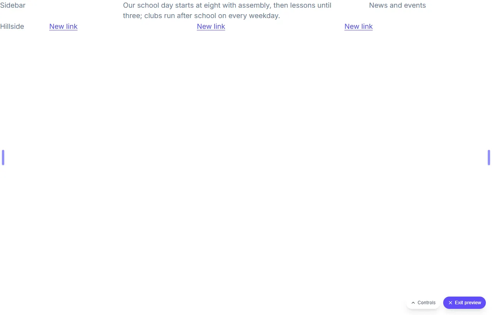](img/guide-set-width-row.webp)

**A Grid's columns, each its own width.** Select a **Grid** and open **Column widths** (under its Columns). Each column a
visitor sees has one of three:

| Choice | What it does |
|---|---|
| **Share** | Takes a share of what the other columns leave (the default). |
| **Fit content** | As wide as what is in it — a logo, an icon, a short label. |
| **Set width** | Exactly the width you type, e.g. `15rem`. |

They are drawn wherever the Grid shows all its columns; where it shows fewer — a phone's single column — the columns are
equal again. They are the same on every screen, so setting them while a phone is selected still changes the desktop.
Column widths need every block of the Grid to be the same number of columns wide; the Inspector says so otherwise.

[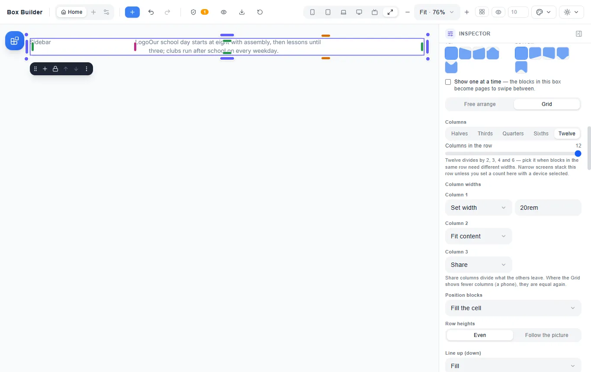](img/guide-column-widths.webp)

**One content width for the whole site.** Open **Layout guides** (or **Page settings → Page grid…**) and set **Content
width** to **Centred**: every section of every page — and every page you add later — puts its words and pictures on one
centred column (75rem to start; the slider goes from 40 to 100), while section backgrounds still run edge to edge. On a
screen narrower than the column, only the page's side space is kept at the edges. The layout guides are drawn inside the
column. **Full width** puts everything back edge to edge; **Ctrl+Z** undoes either.

One section can still run the full width: select it and set **Layout → Arrange → Content width → Edge to edge**. The
Inspector says which sections follow the site and which do not, and a section set this way stays so when the site's width
changes.

[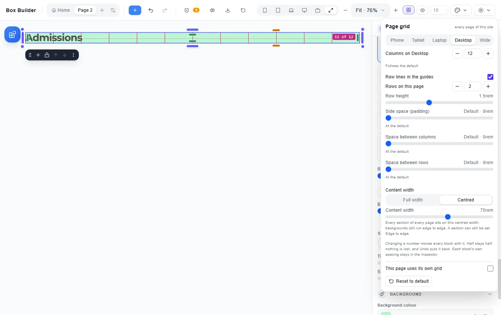](img/guide-content-width-panel.webp)

### Sizes: a shape, limits, and grids that fit

**A block that keeps its shape.** Select any block — a section, a box of words, a picture, a card — and pick a shape under
**Design → Size → Proportion**: 1:1, 4:3, 3:2, 16:9, 2:1, 21:9, or the tall ones 3:4, 2:3, 4:5 and 9:16. Each is drawn as
the shape it makes. The block is then as tall as its width says, on every screen: a 16:9 video box or hero, square staff
portraits, a 2:1 band. **Custom** takes any two numbers, such as `5` : `2`. Words never get cut off: if a box has more
words than its shape holds — on a narrow phone, say — it grows taller to hold them. A picture is cropped to the shape.
Like any size, a proportion can differ by screen (16:9 on a desktop, square on a phone). **Free** turns it off. A shape and
a **Height** are one choice: typing a Height turns the proportion off, and picking a shape clears the Height.

[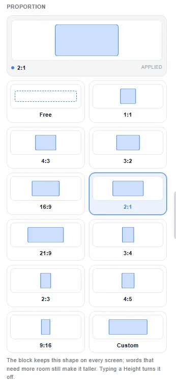](img/guide-proportion.webp)

**Limits — never wider, never narrower.** Under the Proportion, **Limits** has **Min width**, **Max width**, **Min height**
and **Max height**. Type a length — `40rem`, `65ch` (about 65 letters, a comfortable line), or a `%`. A quote or a form with
**Max width 40rem** is never wider than that, and on a phone it simply takes the line. A **Min width** never pushes a block
off the screen: on a phone narrower than it, the block takes the whole line. A **Max height** caps a block that would
otherwise stretch — a full-screen hero that should stop at 40rem on a tall monitor — but never cuts words off: a block with
more words than fit grows to hold them. Empty a field to remove the limit.

[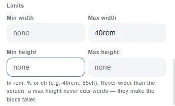](img/guide-limits.webp)

**A sidebar between two widths.** On a row of the page, give one block a **Min width** and a **Max width** — `12rem` and
`18rem` — and it takes its share of the row, but never less than 12rem or more than 18rem; the blocks beside it take the
rest. Where the row is too narrow for both, they stack. In a **Grid**, the same is a fourth choice under **Column widths**:
**Between**, with an *at least* and an *at most*.

**As many cards as fit.** Select a **Grid** and set **Columns** to **As many as fit**, then **Each at least** to a card
width such as `16rem`. The Grid puts as many blocks across as fit at that width — six on a wide monitor, three on a laptop,
two on a tablet, one on a phone — all the same width and filling the row, on every screen, in the order you put them. A
visitor with a bigger text size gets fewer across. **A set number** puts the column count (and each block's columns wide)
back. Blocks in such a Grid are not offered *Columns wide* or *Start at column*: the Grid places them itself.

[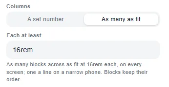](img/guide-as-many-as-fit.webp)

**Spacing on the scale.** Every spacing slider — Inner spacing, Outer spacing, Space between blocks, Space across and down,
and the Page grid's side space and gaps — moves in the steps of the spacing scale (0, 0.25, 0.5, 0.75, 1, 1.25, 1.5, 2,
2.5, 3, 4, 5, 6 rem), by dragging or with the arrow keys, the same steps the spacing handles on the canvas take. So spaces
across the site match. To type an exact value instead, use the Top / Right / Bottom / Left fields, which take any number.

### Lining blocks up: across, down, spread, text lines and push

**Where one block sits.** Select a block and open **Design → Position**. Under the nine squares are two rows: **Across**
(Auto · Start · Middle · End · Fill) and **Down** (Auto · Top · Middle · Bottom · Fill). The nine squares are a shortcut
that sets both at once — pick the middle one and both rows read Middle. **Fill** stretches the block that way: in a row of
cards lined up in the middle, **Down → Fill** makes one card the row's full height while the others stay centred. **Auto**
lets the block sit where the layout puts it. In a Grid, Across places the block in its cell (End puts it at the cell's end,
Fill fills it). Like every size, a place can differ by screen — Middle on a desktop, Start on a phone.

[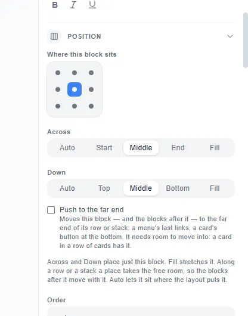](img/guide-position.webp)

**Push to the far end.** Also in Position: tick **Push to the far end** and the block moves to the far end of its row or
stack — and the blocks after it go with it. Push the third of four menu links and the last two sit at the menu's right
end. Push the button of each card in a row of cards and the buttons line up along the cards' foot, however much each card
says. A push needs room to move into: a card in a row of cards has it; a row whose blocks already fill it does not.

**Spreading the blocks of a row.** Select the Stack or Side by side and open **Arrange → Position blocks**: Start · Center ·
End · **Spread out** (the first and last at the ends, the rest between) · **Space around each** (the same room on both
sides of every block, so the ends get half) · **Even spacing** (the same room everywhere, the ends included).

**Lines that wrap.** When **Let blocks wrap to a new line** is on, **Wrapped lines** places those lines in a box taller than
they are — a tag cloud or a logo wall in a section with a height: **Fill** (the lines share the height), **Top**, **Middle**,
**Bottom**, **Spread out** or **Even spacing**. Give the box a height (Size → Limits → Min height) to see it.

**Text that lines up.** A large price beside a small "per term", a heading beside a link: in a side-by-side row or a Grid,
**Line up (down) → Text lines up** puts their first lines of words on one line, whatever their sizes. A top-to-bottom stack
does not offer it, because there it would change nothing.

### Words round a picture, a sideways strip, a section over the one above

**Words round a picture.** Put a picture and some paragraphs in a top-to-bottom Stack, select the picture and open
**Design → Position → Wrap words round it**: **Start** puts it at the start of the line, **End** at the end, and the words
after it run beside it and then back under it to their full width, with a little room between. A new picture takes 40% of
the line (Width shows its default 100%); give it a width of your own — `40%`, `16rem` — and it keeps that. On a narrow
screen (a Stack under 30rem) the picture stops floating — the whole line, or its own width if you gave it one in rem — and
the words follow it. **Off** puts it back.

[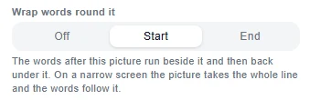](img/guide-wrap-words.webp)

**Words that follow its shape.** Once the words wrap, **Words follow** says what they keep to. **Its box** (the start) keeps
them to the picture's rectangle. **Its round corners** follows the corners you gave it — choose the Image's **Circle** style
for a round head-teacher photo, or **Outline & effects → Rounded corners** — and the lines start where the curve is, the same
little room away all round. **A cut-out's outline** follows what is drawn in a picture with a see-through background (a PNG
cut-out of a pupil, a trophy, the school badge): when you choose it, the builder traces what is drawn in the picture, and the
words come in close wherever the picture is clear. The outline is written into the page, so a visitor downloads nothing more
for it. Replace the picture and the new one is traced. On a narrow screen the picture stops floating and the words go under
it; a picture with a width of its own (the Circle style's 10rem) keeps that width there, so a round photo stays round.

[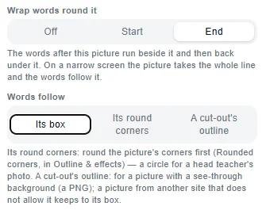](img/guide-words-follow.webp)

**The space round it.** Under Words follow, **Space round it** sets how far the words keep from the picture — beside it,
under it, and round its curve or its outline. It starts at the default, 1rem ("Default · 1rem"); drag it, or use the arrow
keys, to step along the same spacing scale as every other space, from 0 (the words right up to the picture) to 2.8rem on a
phone — the slider shows each step's size from a phone to a wide screen, as every space grows with the screen and with the
reader's text size. Set it on **Mobile** to give a phone its own space.
**Back to default** puts the 1rem back.

[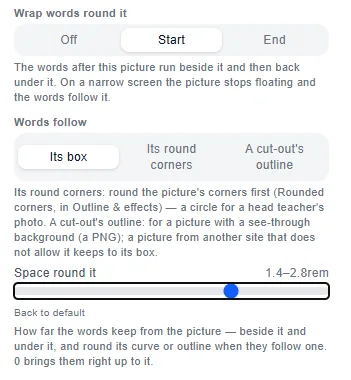](img/guide-space-round.webp)

**A sideways strip.** Select a Side by side, open **Arrange → When it doesn't fit** and choose **Scroll sideways**: its
blocks stay on one line that visitors swipe or scroll, a part of the next one showing, each swipe landing a block at the
start. The page itself never scrolls sideways. Keyboard users reach the strip with Tab and move it with the arrow keys.
Choose it on Mobile only and a phone gets the strip while a desktop keeps wrapped lines. **Wrap to new lines** puts it back.

**A section over the one above.** Select a section of the page (not the first) and open **Arrange → Overlap the section
above**: **Small · Medium · Large · Extra large** pull it up over the foot of the section above and draw it in front. The
section above grows by the same amount, so nothing in it is covered. Set **Off** on Mobile to keep a phone plain.

[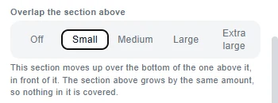](img/guide-overlap-above.webp)

### What you get in the ZIP, and why it's built that way

| | |
|---|---|
| **One file per page** | Each page has its own address, so it can be found, bookmarked, shared and printed on its own. Your home page is `index.html`, which is what every web host looks for. |
| **Links are relative** | Unzip it onto a laptop, a USB stick or a web host and every link still works. Nothing assumes a domain. |
| **One shared `styles.css`** | A visitor downloads it once, then it is cached — every page after the first arrives faster. |
| **Each page carries only the styles it uses** | A term‑dates page of text and a table doesn't download the accordion, the alert or the rating — and a page with one accordion doesn't download the other twenty‑eight accordion designs either. A page of text ends up around 1.4 KB; a busy page with an alert, an accordion, a card and a photo, around 10 KB. |
| **The next page is already on its way** | While a visitor reads one page, the browser quietly fetches the others in the background. Clicking a link then feels instant. |
| **Photos are their own files, in `images/`** | The words of a page arrive first and the photos follow, so a parent on a slow connection can start reading straight away. A photo used on several pages is one file, downloaded once. A photo lower down the page isn't downloaded until the visitor scrolls to it. |
| **Every screen gets the photo size it shows** | Every photo wider than 480 pixels also comes in a 480 and a 960 pixel copy. When you export, the builder lays each page out at every screen size and measures how wide each photo really is there: the whole width on a phone, a third of the row on a desktop, a card in a grid. The page tells the browser exactly that, so a phone downloads the small copy, and a desktop showing three photos across downloads the 960 copy, not the full 1600 pixels. |
| **Background videos are their own files, in `videos/`** | A video you uploaded travels in the ZIP. One you linked plays from its address. Each comes with its poster photo in `images/`. |
| **Fonts are their own files, in `fonts/`** | A visitor only downloads the letters the page uses. An English page needs the basic Latin letters, about 44 KB. A page with Yoruba ẹ ọ ṣ, Hausa ɓ ɗ ƙ or Twi ɛ ɔ downloads one more small file, so those letters appear in your typeface too, never in a different font halfway through a word. |

**Your fonts travel with the site.** The typefaces you chose are inside the ZIP, in `fonts/`, so the published site looks exactly like the one you designed. They are *not* loaded from Google: that would mean every visitor's IP address is sent to a third party, which is a data-protection question no school should be handed without being asked. Nothing is loaded from a third party for fonts or tracking. The few small scripts some blocks need are built into the pages themselves, and the pictures you uploaded travel in `images/`. Stock photos and embedded videos still load from where they live, so those need a connection.

**Why it's built this way: a parent on a 3G phone.** Before this change a typical school page weighed about 500 KB, because every font and photo was packed inside the page. On a slow 3G connection the first words took about 14 seconds to appear. With fonts and photos as separate files, the first words arrive in about 4 to 5 seconds — measured on six pages built in the builder, each now around 100 KB.

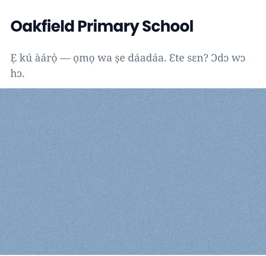

### A video behind a section

**What you want:** the top of your home page with a few seconds of the school field, the choir or the classroom
moving quietly behind the welcome words.

**What you do:** select the section, open **Design → Background**, and find **Video** at the bottom.

| Control | What it does |
|---|---|
| **Upload a video** | Pick an `.mp4` or `.webm` file from your computer or phone, up to 20 MB. A loop of 5 to 10 seconds is plenty. The video is kept in this browser, and your page only remembers which video it is. |
| **Video address** | Or paste the address of a video file that is already online. It must end in `.mp4` or `.webm`. A YouTube or Vimeo page cannot play behind a section; use a **Video** block for those. |
| **Upload a poster** | The still picture shown before the video plays, and instead of it. The builder takes one from the first frame for you; upload your own to choose a better moment. |
| **Tint over background** | A colour laid over the video and under your words, so they stay readable. A dark tint (60 % black) arrives with the video, and the words turn light to read on it — enough that they stay readable even on the brightest frame. Change its colour or strength, or open its palette and choose **Clear** to take it off. The same happens when you add a background photo. |
| **Remove video** | Takes the video and its poster off. **Ctrl+Z** brings them back. |

**What you see:** on the canvas the video plays, silent, behind the section's words. In **Preview**, and on your
published site, a small round **Play / Pause** button sits in the corner. Visitors can reach it with the Tab key
and stop the video at any time.

**If your words might be hard to read:** a picture moves and changes, so nobody can promise every frame is readable. The tint is what keeps them readable. If you take the tint off, the **Page check** names the block and tells you how to put one back.

**What a visitor on a phone sees:** the video only plays when it costs them nothing they didn't choose.
- A visitor whose phone is set to **reduce motion** sees the poster.
- So does a visitor on **data saver** or a slow 2G or 3G connection. The video isn't downloaded at all.
- Either of them can still press **Play**.
- The video never has sound, and screen readers skip it, because it is decoration. Anything a visitor needs to
  know belongs in the words.

**If you move to another computer:** an uploaded video lives in the browser you uploaded it from. Export from
another browser and the builder tells you which videos it could not include. The site then shows their posters.
Upload the video again there, or use a video address, which works from anywhere.

### Fonts that write your language

Not every typeface has every letter. A word in Yoruba, Igbo, Hausa, Twi, Ga or Ewe uses letters such as ẹ ọ ṣ, ị ụ,
ɓ ɗ ƙ and ɛ ɔ ŋ. When a font lacks one, the browser borrows that letter from another font, so it looks different from
the rest of the word.

**A new site starts with fonts that have them all:** **Montserrat** for headings and **Inter** for words. A site saved
before 15 October 2026 keeps the fonts it already had (Poppins and DM Sans) until you choose others.

**The site's fonts are in Page settings.** Open the page's menu (the settings button beside the page name) and find
**Site fonts**:

| Control | What it does |
|---|---|
| **Headings** | The font of every heading that has no font of its own. |
| **Words** | The font of every other block's words that has no font of its own. |

Each font in the list says which of the region's languages it writes, in words, for example *Writes Yoruba · Igbo ·
Hausa · Twi / Ga / Ewe*, *Writes Yoruba · Igbo only* or *Writes none of Yoruba, Igbo, Hausa, Twi*. The line under each
field says it for the font you chose. A block with a font of its own keeps it. One **Undo** puts back the last change.
**Esc**, or a click anywhere outside it, closes Page settings.

[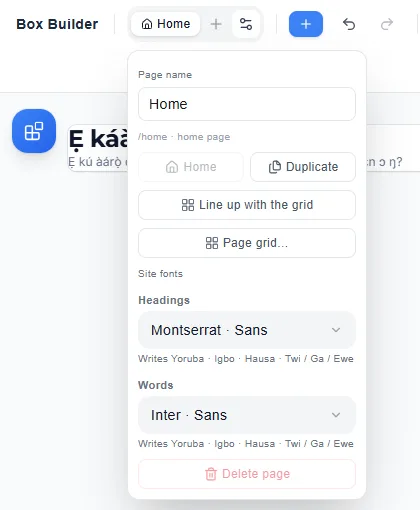](img/guide-site-fonts.webp)

Every other font picker in the builder says the same thing under each font's name: a block's **Text style**, a box's
**Text style (everything inside)** and a component's **Typography**.

The fonts that write all four: **Inter, Montserrat, Merriweather, EB Garamond, Libre Baskerville, Noto Serif, Anton**
and **Great Vibes**. If your words use a letter the font lacks, the **Page check** says so (§14b).

---

## 10b. Bands: edge to edge, or a centred column

Every top-level block sits in a full‑width band across the page. Select it → **Design** tab → **Arrange** → **Content width** to choose **Edge to edge** or **Centred column** — what each does, and how a block lands beside one or underneath it, is told in [the story, §1](./layout-story.md#1-the-three-shapes-and-the-band).

**Centred column** is the setting that makes a page look professionally made. A heading stretched across a 27‑inch monitor is genuinely hard to read — the eye loses its place coming back to the start of the next line — so the text is capped at a comfortable measure that **widens by one step** as the screen grows: a phone gets the full width less a margin, a tablet ~34rem, a large tablet ~52rem, a desktop ~68rem, a very large screen ~76rem.

On a phone the column always keeps a margin, so text never touches the edge of the screen.

While you drag a block into the empty space beside another, the insertion line tells you what you will get: a **vertical line** means side by side (the block already there keeps its width), a **horizontal line** means a new full‑width band underneath. **Ctrl+Z** puts it back.

---

## 10c. Grid — laying a page out like a table

Most page layouts are a row split into parts: a wide article beside a narrow sidebar, three cards across, a photo next to some words. In the Blocks panel that's **Grid**.

### Pick the shape, don't do the sums

Click **Grid** and you get a little grid. Sweep across it — *4 across, 3 down* — and click (any count from **1 to 12** across: a count twelve divides is twelfths underneath, any other — five, seven… — is that many equal columns; the arrow keys and Enter work too). You get twelve empty cells arranged exactly like that, the same way you'd insert a table in a word processor. Underneath the picker are the uneven shapes a sweep can't express: **Sidebar left · 4 · 8**, **Sidebar right · 8 · 4**, **Feature + two · 6 · 3 · 3**, **Wide + narrow · 7 · 5**.

**Dragging Grid asks the same question.** Drop the tile where you want the layout and the picker opens right there. Dragging says *where* the layout goes; it doesn't say what the layout *is*, so nothing is added to the page until you've chosen a shape — and pressing Escape (or clicking away) leaves the page exactly as it was.

### Twelve columns underneath

A Grid block is **twelve columns** underneath, and each block in it takes a number of them. (The page grid itself is six columns on a phone and can be set to sixteen — see [the story, §6¾](./layout-story.md#6-the-whole-page-is-mine--the-page-grid).) Twelve because it divides evenly by 2, 3, 4 and 6 — so halves, thirds, quarters and sixths all come out exact.

You never have to think in twelfths. Select a block and the **Grid cell** panel offers the names — **Full, Half, Third, Two‑thirds, Quarter, Three‑quarters** — with the raw number underneath if you want it. Pick a Half inside a row of thirds and the row quietly re‑cuts itself to twelve so it can express one; nothing on the page moves.

**A different count on one screen.** On a phone a Grid stacks its blocks one under another, and with **Mobile** selected the **Columns** control says so: none of the names is picked. Choose one there (say **Thirds**) and the phone shows that many across, each block keeping its share of the row (a quarter of the row on a desktop stays as close to a quarter as the new count allows). The desktop is left exactly as it was. If the blocks get too narrow for their words, the **Page check** says which one, and on which screens.

| Control | What it does |
|---|---|
| **Width** | How much of the row this block takes — by name, or 1–12 |
| **Start at column** | Leave columns empty before it (an offset) |
| **Rows tall** / **Start at row** | The same two things going down, so a block can straddle rows |
| **Across** (under **Position**) | Where the block sits across its own cell — Start, Middle, End or Fill. It and the nine squares are the same setting, and both show it |

### Drag a cell's edge

Select a cell and drag its edge. It behaves like a table: **the boundary between two cells is shared**, so widening one narrows its neighbour and the row stays put — nothing else on the page jumps. Keep going and the neighbour stops shrinking once it's too narrow to read and **wraps to the next row**, letting the cell you're dragging reach the full width of the page.

**And it comes back.** A wrapped neighbour keeps the width it had — wrapping moves it, it doesn't resize it — so when you drag the cell back in, the neighbour returns to the row and widens by exactly what you gave up. Drag out and back and you land precisely where you started. The row always adds up to the full twelve.

**The edge you grab is the only one that moves** — on all four sides. Drag the **left** edge and the cell before yours gives up exactly that much room while your right edge stays put; drag the **right** edge and your left edge stays put. When the cell next to you has no more room to give, yours simply stops growing rather than sliding out of its far side.

Dragging the **bottom** edge sets that **whole row's height**, so the row grows as one and the page grows with it. Dragging the **top** edge moves the boundary between your row and the one above: that row gives back exactly what yours takes, so your bottom edge doesn't budge. If the row above is already only as tall as the things inside it, there's nothing to give and the edge stays where it is — nothing is pushed down the page to make room.

**A drag is one gesture.** The canvas shows the result as you drag, letting go commits exactly what you were being shown, and one **Ctrl+Z** puts the whole drag back — not one frame of it.

**Typing is one step too.** Type a sentence and one **Ctrl+Z** takes the whole sentence back, not one letter. Your words are saved when you pause, and straight away when you click out of the block, press Escape or Enter, switch tabs or close the page — so nothing you typed is lost, and typing stays quick on a slow phone even on a long page.

### How small a box can go

**An empty box shrinks to almost nothing.** The *"Drop a block here"* message is a hint for you, not content on the page, so it never sets a floor — drag the bottom edge all the way up and the box follows.

A box you haven't sized yet stands about **8rem** tall so you can see it, click it and drop into it — the same height the published page gives an empty coloured box. That's an offer, not a rule: the moment you set a height, your height is what you get, on the canvas and in the published page.

**A box with something in it stops where its content stops.** One line of text shrinks to about one line — the content sets the limit, not a number the builder picked. And empty boxes *inside* a box you've sized never hold it open: squeeze a section holding an empty grid and the grid comes with it.

### Empty space is allowed

If a row has columns left over, hover it (or select something in it) and an **Add a block here** target appears, exactly the width of the gap. It's hidden the rest of the time — empty space in a layout is a legitimate choice, not a mistake to be corrected.

### Grids inside grids

A cell is just a container, so **anything you can do to the page you can do inside a cell** — including adding another Grid block with its own columns and rows, as deep as you like. Each one carries its own spacing: **Space between blocks**, plus **Space across** and **Space down** separately when a row wants more air between its columns than between its rows, and Inner/Outer spacing per side.

**All three are sliders.** Spacing is something you judge by eye, so you sweep it and watch the canvas rather than typing a number and looking. Space across and Space down start out *matching* Space between blocks — sweep one and it takes on a value of its own, and the line underneath offers it straight back to matching whenever you want it. A whole sweep is **one Ctrl+Z**, however many times the slider ticked on the way.

A grid inside a box starts **full width with no padding**; a grid placed straight on the page gets the page's usual side space, so its words never touch the edge. Either way, every spacing control can be changed, down to zero.

### Row heights — even, or following the picture

A row normally gives every block in it **the same height**: whatever the tallest one needs. That is right for a row of cards, and wrong for a row of photographs — a tall portrait forces everything beside it to stretch, and the wide ones get cropped to match.

Select the grid, open **Arrange**, and you'll find **Row heights**:

| | |
|---|---|
| **Even** | Every block in a row is the same height. This is what every page has always done — nothing changes if you never touch it. |
| **Follow the picture** | Each block is as tall as what's inside it, and the one below fills the first gap that opens up. Photographs of different shapes sit together without any of them being cropped. |

**Everything else keeps working.** Column widths, offsets, order, per‑device settings, corners, spacing, backgrounds — none of it changes. This is a setting on the row, not a different kind of block, which is why you can turn it on and off freely.

**Your blocks still read in the order you put them in.** Left to right, then down — so a caption that says "1, 2, 3" still says 1, 2, 3, and someone using a screen reader hears them in that order too. (The usual trick for this effect runs the content *down* each column instead, which reads wrongly for anything numbered or newest‑first. This doesn't.)

**Spacing.** **Space down** is the air beneath each block; **Space across** separates the columns. They're independent, as they are on any row.

**On a phone** it narrows the way any grid does (below); once it is down to a single column there's nothing to stagger.

#### When your blocks aren't photographs

The builder knows how tall a photograph will be — it measures every picture when you add it. It cannot know how tall a card or a caption will be until the page is actually open in someone's browser, so it assumes a sensible shape and the spacing comes out a little loose.

For those, tick **Measure on the page**. A small script measures the real heights once the page loads and sets the spacing exactly, then does it again when the window is resized, when the fonts arrive and as each photograph loads.

It's off by default because your published pages carry **no JavaScript at all** unless you ask for some. And it only ever improves things: with scripting switched off, the page still staggers and still never crops — the spacing is just less exact.

### On a phone

A grid keeps its count while each cell still has about 12rem — three cards stay three across on a tablet — and narrower than that it goes to two, then one. It gives up columns evenly and never breaks a word, and a grid inside something narrow narrows by its own box. All of that is told in [the story, §3](./layout-story.md#3-three-cards-across-that-stack-on-a-phone). If you want something different, pick the device at the top of the screen and set **Columns** there; the row then does what you said from that size down.

**If you placed the cells yourself, the placement is released when the row narrows.** *Start at column* and *Start at row* are written in the wide row's twelve columns, and there is nowhere to put "column 9" in a row that now has fewer. So at those sizes the cells simply **flow** — one after another, in the order you added them, wrapping onto new rows. **Setting Columns for a device works the same way.** Your *Start at column* was written in the twelve-column row's units, so it's released there too and the cells flow. If you want an exact placement at that size, set **Start at column** on the cell *while that device is picked* — then it's read in that row's own units and honoured exactly.

Everything in this section is per‑device. Setting **Order** on a phone is what puts the photo above the words there and beside them on a desktop. It moves only what is seen — a screen reader and the Tab key still follow the page — so the **Page check** names a block whose Order makes the two differ (§14b).

---

## 10d. Styling a box and everything in it

Select any container — a section, a grid cell — and open **Text style (everything inside)** on the Design tab.

Whatever you set there — font, colour, size, boldness, line spacing, alignment — **everything inside follows**: headings, paragraphs, lists, buttons and components alike. Style one block on its own afterwards and that block keeps its own look; the box only supplies what a block hasn't decided for itself.

Text size is proportional, not flat: making a cell's text bigger scales its heading and its body together, keeping the heading larger than the body rather than collapsing them to one size.

Backgrounds, borders, corners and padding stay with the box itself — they're the box's own shape rather than something its contents inherit.

---

## 10g. Sloped and curved section edges

Bands don't have to meet in a straight line. Select one → **Design → Arrange → Edge shape**, and pick a shape for its **top** and its **bottom** independently:

- **Straight** — the default
- **Slope right** / **Slope left** — a diagonal cut
- **Curve out** / **Curve in** — an arch: Curve out bulges (its corners are cut in by the depth, its middle reaches the edge), Curve in scoops inward

**Edge depth** controls how far the shape cuts, as a percentage of the section's height. It's capped, so a shape can never swallow the whole band.

Each choice shows you the shape rather than naming it, so you pick a picture.

Two things worth knowing:

- **The shape cuts the background; it doesn't move your content.** A sloped section is exactly as tall as it was — so text stays where you put it and nothing reflows when you change the shape.
- **It's the section underneath that shows through.** A slope on the bottom of a blue section reveals whatever comes next, so the effect reads best between two sections of different colours.
- **A shadow follows the shape.** Give a shaped section a Shadow and the shadow is cast by the curve or the slope, not cut off by it — on the canvas and on the published page alike, and a Lift, Glow or Brighten hover keeps to the shape too. (A border on a shaped section stays a straight rectangle.)
- **A shaped section holds what is inside it.** A block set to *Floats on screen* inside a shaped section stays with that section, not the window — the Inspector says so. Put such a block outside the shaped section.

---

## 10f. A section that fills the screen

Select a section → **Design → Arrange → Screen height**:

- **Fit content** — as tall as whatever is inside it. The default.
- **Half screen** — half the visitor's screen.
- **Full screen** — a hero exactly one screen tall, the thing people mean by "make the front page look like a proper website".

It's a **minimum, not a fixed height**. If the words inside outgrow the screen the section gets taller rather than hiding them — so a long headline on a small phone still reads in full.

Two things it handles for you. It uses the *conservative* measure of screen height, so a full-screen section always fits on arrival rather than being pushed under the phone's address bar. And because it's a floor, a section that's still empty while you're building it stays full height instead of collapsing to nothing.

**A whole screen means a whole screen.** A header that stays at the top is not taken off it: the section is exactly the
visitor's screen tall on every phone, tablet and monitor, with the header sitting over its top as the page scrolls.
**On the canvas, the screen is the part of the canvas you can see** — pick Mobile and a Full screen section fills the
canvas view from top to bottom, Half screen half of it, rather than the height of your editing window.

---

## 10e. Putting a block where you want it

Select any block and open **Position** on the Design tab. You get nine squares — top-left, top-centre, top-right, and so on down to bottom-right. Click one and the block goes there. Click the same one again to let it sit wherever the layout puts it.

It **moves only that block**; its neighbours stay exactly where they were.

The nine squares mean the same thing wherever you use them, which is the point — a section, a row, a grid cell, at any depth. Underneath, the builder works out which CSS a given parent needs (that answer changes depending on whether the parent stacks top-to-bottom or side-by-side, which is not something you should have to think about).

**One thing worth knowing about grids.** Inside a grid, a block is positioned within **its own cell**. If you want to move it across the whole row instead, change how many columns it takes or which column it starts at — that's what those controls are for.

If you'd rather place something completely freely, use **Placement → Floating** and drag it anywhere. That lifts it out of the layout onto its own layer.

### Selecting the box you mean

Click once for the outer box, click again to go inside, **Escape** to step back out — see the reference, [Block toolbar](./layout-reference.md#block-toolbar).

**Where am I?** A heading three boxes deep shows one outline on the canvas, and nothing else tells you what it
sits in. So the top of the Inspector names the boxes around it, outermost first:

> Editing: Stack › Side by side › **Heading**

[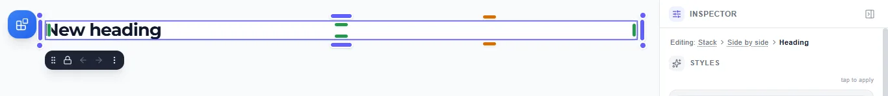](img/guide-selection-trail.webp)

The last name is the block you have selected. Every name before it is a button: click **Stack** and the Stack
is selected — on the canvas and in the Inspector — without hunting for its edge. It works with a tap on a phone or
tablet, and with the keyboard (**Tab** to a name, **Enter** to select it; the focus moves to the new name, so the
next **Tab** carries on from there).

The trail lists exactly the boxes **Escape** steps out through, in the same order. A block straight on the page
has nothing around it, so it reads just "Editing: Heading". Choosing from the trail only changes what is selected,
so **Ctrl+Z** still undoes your last real change.

---

## 11. Keyboard shortcuts

| Action | Shortcut |
|--------|----------|
| **Edit the selected block's text** | **Enter** or **F2** (the caret lands at the end, so you carry on typing) |
| Undo / Redo | Ctrl+Z / Ctrl+Y or Ctrl+Shift+Z |
| Copy / Cut / Paste | Ctrl+C / Ctrl+X / Ctrl+V |
| Duplicate | Ctrl+D |
| Delete | Delete / Backspace |
| Move a block in the layout one place earlier / later | ↑ / ↓ |
| Nudge a floating block 2px (12px with Shift) | ↑ ↓ ← → |
| Float ⇄ flow | Alt+F |
| Group / Ungroup | Ctrl+G / Ctrl+Shift+G |
| Lock / Unlock | Ctrl+L |
| Bring forward / to front (floating) | Ctrl+] / Ctrl+Shift+] |
| Send backward / to back (floating) | Ctrl+[ / Ctrl+Shift+[ |
| Open / close the Blocks panel | B |
| Open Blocks panel + focus search | / |
| Step out of the selected block (then deselect); close the Blocks panel | Escape |
| Layout guides on / off | Shift+G |
| One page-grid column more / fewer (Shift: half) | Alt+← / Alt+→ |
| Hide / show the Preview's controls (in Preview) | H |

The complete list for layout is in the reference: [Keyboard shortcuts](./layout-reference.md#keyboard-shortcuts-complete-list-for-layout).

---

## 12. Component guide — Accordion

The **Accordion** is a stack of expandable panels (FAQ, term dates, policies, help topics). It's built on native `
`/`
`, so it needs **no JavaScript** (unless you tick one of the options below), works in the exported site, and is **keyboard‑ and screen‑reader‑accessible out of the box**.

**Add one:** Blocks panel → **Accordion**. You'll be offered a starting design — **Default**, **Q & A**, **Solid panel**, **Split (media)**, **Timeline** or **Enclosed card** — and it arrives ready to edit.

[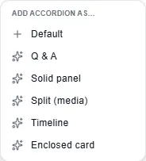](img/guide-accordion-starts.webp)

### Pick a design, then fine‑tune it

Select the accordion → **Content** tab. You'll see two things:

[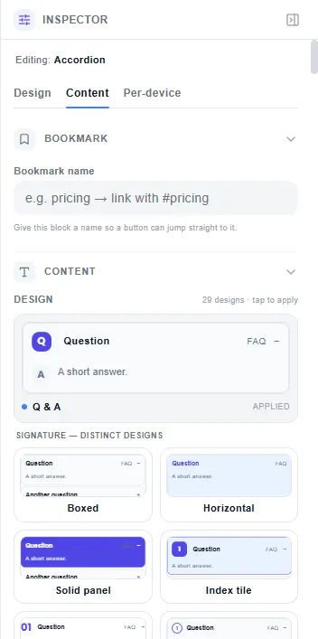](img/guide-accordion-content.webp)

**1. Design — 29 looks, shown as live previews.** Not names in a list: each tile renders a real miniature accordion, so you pick what you can see. Two families:
- **Signature (24)** — Boxed (the default), Horizontal, Solid panel, Index tile, Big number, Ring step, Chat bubble, Q & A, Callout, Float, Folder tabs, Editorial, Menu pills, Enclosed card, Dark glossy, Two‑column, Quote, Glass, Timeline, Alternating, Colour stripe, Spotlight, Folded corner, Split (media panel).
- **Quiet & minimal (5)** — Ghost, Line, Minimal, Underline, Soft.

**2. Fine tuning — six settings that combine with *any* design.** This is the important part: they're **independent**, so "Timeline" *and* "Numbered" *and* "Compact" can all be true at once.

| Setting | What it changes | Choices |
|---------|-----------------|---------|
| **Indicator** | The marker that says a row opens | Chevron · Arrow · Plus circle · Tag dot · Switch · On the left |
| **Frame** | How each row is framed | Outline · Elevated · Dashed · Pill · Square |
| **Rhythm** | Spacing and separators between rows | Flush · Separated · Divided · Zebra · Rail |
| **Open colour** | What an open row looks like | Filled · Accent edge · Brand header · Body tint · Gradient when open · Gradient bars |
| **Numbering** | Row numbers | Numbered · Stepper |
| **Density** | Room per row | Large · Compact |

The panel shows **how many you've changed** and gives you one **Reset** to put them all back. A changed setting is marked with a dot as well as a colour, so it reads without relying on colour alone.

> **Why it's built this way:** these used to be mixed into a single list of over fifty "designs", which meant picking Timeline *replaced* Numbered instead of combining with it. Splitting them means the gallery only contains things that genuinely look different, and the combinations you actually want are reachable.

### Everything else

**Full CRUD on every item.** Title, Body, optional Meta (a right‑aligned price or badge), an Image thumbnail, a Number/badge, and **Open by default**. Add, duplicate, remove and reorder (▲/▼) any item — the last one can't be removed, so it's never empty. Click a panel's title or body **directly on the canvas** to edit in place. **An item's picture** can be pasted as a web address or uploaded from your device with **Upload item 1 picture** (it becomes **Replace…** once there is one); like every picture you upload, it is resized to 1600 pixels, and the address box then says *Uploaded picture — or paste a URL* rather than showing the picture as text.

**Numbers you control.** Numbered designs count `01, 02, 03…` automatically; type your own value in an item's **Number/badge** field to override just that one.

**Style each item's Header and Content — no CSS needed.** Text colour, fill, font, size, **weight, letter spacing, capitals, corner radius, padding, border**, alignment, and free **Move ← → / ↑ ↓** nudging in rem. These win over the chosen design, so one item can look completely different — a highlighted "featured" row, for instance.

**Move an item freely.** Toggle **"Move freely"** on any item to lift it out of the stack and place it exactly where you want — drag on the canvas or type X/Y. It stays inside the accordion's box, and on phones it returns to the normal stack so the page stays readable.

**One open, or many.** By default one panel opens at a time; tick **"Allow more than one open at once"** to change that.

**Expand / Collapse all (optional).** Tick **Show "Expand all / Collapse all" controls** to add two buttons above the panels.

**More options, all off by default:**
- **Show a search / filter box** — visitors type to narrow the list.
- **This is a FAQ — add SEO rich‑results markup** — tells search engines the panels are questions and answers.
- **Category** (per item) — a heading that groups items (e.g. Billing, Shipping).
- **Sub‑items** (per item) — a nested accordion inside the item.

Expand / Collapse all and the search box each add a tiny script; so does giving an item a link name. Without them the accordion has no JavaScript.

---

## 13. Component guide — Alert

The **Alert** carries one message that matters: a closure notice, an open day, a fees deadline, a "we've moved" banner. It's a **single message** by design — a list of notifications is a different thing, and mixing the two makes both worse.

**Add one:** Blocks panel → **Alert**. You'll be asked what it's for — **Information · Success · Warning · Error · Announcement bar · Docs callout** (or **Default**) — and it arrives already looking like that job, rather than as a blank you have to configure.

### Severity — what kind of message it is

Six: **Info · Success · Warning · Danger · Neutral · Brand**. The severity chooses the colour, the default icon, *and* how a screen reader announces it — warnings and errors interrupt, the rest wait their turn. Nothing depends on colour alone.

### Form — where it sits

| Form | Where it appears |
|------|------------------|
| **Inline** | In the flow, next to what it refers to |
| **Banner** | Edge to edge across a section |
| **Callout** | A persistent note that loads with the page |
| **Toast** | Floats in a **corner** — pick top‑left, top‑right, bottom‑left or bottom‑right |

### Design — 23 looks, and six things that combine with them

Same shape as the Accordion. **Design** is a visual gallery in four families:
- **Filled & tinted (6)** — Soft, Solid, Gradient, Duotone, Inset, Quiet
- **Outlined & ruled (7)** — Outline, Framed, Left accent, Top accent, Underline, Bracket, Striped edge
- **Raised & layered (5)** — Card, Elevated, Hard shadow, Glass, Sticky note
- **Shaped & characterful (5)** — Icon panel, Ribbon, Ticket, Speech bubble, Terminal

**Fine tuning** — six independent settings: **Shape** (6) · **Border** (8) · **Icon** (8) · **Density** (3) · **Emphasis** (5) · **Layout** (6). Every one combines with every design.

### Actions — buttons and links on the message

Add up to **two** actions ("Read the letter", "Pay now", "Book a place"). Each has:
- **Label**, and where it **goes to** — a web address or a #bookmark on the page
- **Style** — Filled, Outlined, or a Text link with an arrow
- **Open in a new tab**
- Full styling: colour, fill, font, size, weight, spacing, capitals, corners, padding, border, and free placement anywhere in the alert

**Where they sit:** under the message, or on the right. On a phone they always stack underneath, so a button is never pushed off the side.

> A **toast** takes only **one** action. A message that hides itself is the worst place to put a decision, and two buttons in a corner is how people miss both.

### Behaviour — all optional, all off by default

- **Dismiss (×)** — lets a visitor close it
- **Hide itself after N seconds** — shows a countdown bar, and **pauses while a visitor hovers or tabs into it**, so nobody loses a message mid‑read
- **Stay dismissed on the next visit** — remembers, per visitor

Leave all three off and the exported alert contains **no JavaScript at all**.

### Everything else

The message's **title, body, icon, meta and image** are each individually stylable, positionable and freely placeable — the same controls as the Accordion's items, plus per‑item Advanced CSS.

---

## 14. Movement — hover, entrance and arrival

Every block on the page — a section, a component, a button, an image — can be given movement. It's all **pure CSS**: nothing is added to your exported site, and what you see while editing is what a visitor gets.

Select any block → **Design** tab → **Outline & effects**.

### Hover & focus — how it reacts

Eight effects, shown as previews: **Lift · Grow · Press · Glow · Outline · Brighten · Soften**, and None. **Press** does nothing on hover — it sinks in when the block is pressed, so its tile is drawn pressed in. Every effect also dips slightly when pressed; hover looks only happen where there is a mouse, so a tapped card on a phone never stays lifted.

Each one also applies when a visitor **tabs to it with a keyboard**, and to a card when a button *inside* it takes focus — so someone not using a mouse gets the same feedback.

### Entrance — how it arrives

Eight effects: **Fade in · Rise up · Drop down · From the left · From the right · Zoom in · Sharpen**, and None.

Two options go with them:
- **Play when it scrolls into view** — instead of on load. It plays **once**, the first time the block comes into view, and never again or backwards as the visitor scrolls up — on the canvas exactly as on the published page, a pinned bar included.
- **Bring the blocks inside in one after another** — the contents arrive in sequence rather than together. On a section, that's its blocks: a row of three cards rising one after the other as a visitor scrolls to it. On an accordion it's the **rows**, so the list reads as a set of things rather than one lump.

### Movement on a single row

The same two choices are offered **per item** — on each row of an accordion, and on an alert's message. Select the accordion or the alert → **Content** tab → in the item (an accordion row, or the alert's message) → **Hover & focus** and **Entrance**.

They're the same effects, from the same catalogue — a row's Lift *is* a block's Lift. Use them to make one FAQ row respond on its own, or have an alert's message rise in on its own while the rest of the page sits still.

One difference worth knowing: an item's entrance never staggers its own parts. A row's title and body arrive together, because an item is one thing — its title and body are its parts, not a list.

### Two promises

**Nothing can hide your content.** Every entrance animates *from* hidden *to* the block's normal appearance — so if the animation never runs (an old browser, a printer, a slow connection), the content is simply there. An animation can never leave a page blank.

**Reduced motion is respected.** A visitor whose device asks for less motion gets the meaning without the movement — a Lift keeps its shadow, an entrance shows the content immediately.

---

## 14b. Pages everyone can use — meaning, headings and the Page check

Your page is published as proper HTML5, however you built it — you do not need to know what that means.

- **The main part of the page is found for you.** Mark your top band **Page header** and your last band **Page footer**
  (select it → Design → **Meaning** → *What is this block?*) and everything between becomes the page's main content.
  Mark nothing and the whole page is the main content. A **Skip to content** link is added for keyboard users — it is
  invisible until someone presses Tab.
- **Headings follow the page.** The first heading of your content is the page's title (level 1), later ones level 2, and
  a heading inside a **Section** or **Article / card** sits one level below. You can set a level by hand under
  **Meaning → Heading level**; the size is separate, under Text.
- **A card's title is never the page's title.** A card, a quote, a sidebar or a menu is a self‑contained piece, so its
  heading titles that piece, not the page. If your content opens with a row of cards, the first heading *outside* them
  becomes the title; a page whose content is only cards is titled by the school's name in the header. And when the title
  heads a section, the cards inside that section sit one level under it (2), not two — no level is skipped.
- **Cards and quotes are already right** — a Card is published as an article, a Quote as a figure.
- **The links in your header and footer are a menu.** Two or more **Link** blocks one after another in the Page header
  or the Page footer — on one line, or one under another down a footer column — are published as a menu: a list of
  links a screen reader can find and count ("navigation, list, 4 items"). Nothing on the page moves, and no bullets
  appear. A logo or a Button beside them is left out of the menu; two Buttons side by side, a single Link and links in
  the page's main content are left as they are, and a box you marked **Menu** or **List** yourself keeps your choice.
  The Page check's *Fixed for you* says it, with **Show me**.

  
- **The Page check** (toolbar) shows a number when something needs *your* words: a picture with no description
  ("Describe this picture for people who can't see it" — type it right there and press **Save description**, or choose
  *It's only decoration*), or a button or a link with no words. It also flags a picture with no image yet, a heading
  that skips a level (one click: **Make it level N**) and words too tight to sit side by side on a narrow screen —
  those three are suggestions; it won't stop you publishing. Every item has **Show me**, which takes you to the block.
  Everything else is fixed for you and listed under *Fixed for you*.
- **Space, measured at every screen size.** When it opens, the Page check also measures the page as visitors will get
  it, on a phone, a tablet held upright and sideways, a desktop and a wide screen. It names any block whose words come
  closer than 1rem to the page's edge, words that touch the edge of their coloured box, two sections whose words run
  together, and a column too narrow for its words (a word broken in the middle, say four columns you set for phones),
  and says on which screens. Add the space, or give the column more room, and the item goes. These are suggestions too.

[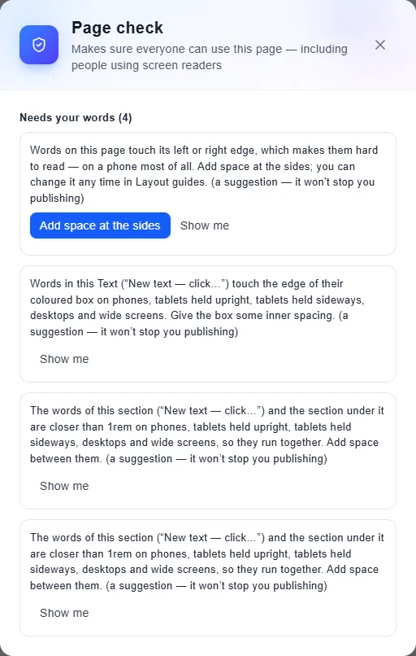](img/guide-page-check-space.webp)

- **Letters the font lacks.** When a block's words use a letter its font cannot draw, the Page check names the font,
  the letters and a font of the same kind that has them: *"DM Sans has no ẹ ọ ṣ … Inter has them."* One click, **Use
  Inter for this block**, changes that block's font. To change it everywhere, use **Site fonts** in Page settings. This
  one is a suggestion too.
- **Shown in one order, read in another.** **Order** moves what a visitor *sees* on a screen — the photo above the
  words on a phone, say. Someone using a screen reader, or moving through the page with the Tab key, still meets the
  blocks in the order they sit in the page. When an Order makes the two differ, the Page check names the block with its
  first words and the screens it happens on: *"On phones, the Button (“Apply now”) is shown in a different place from
  where it is read."* Often that is what you want — then leave it. If the block's place matters (a button that only
  makes sense after the words before it), move it in the page instead, or put its Order back to the default on that
  screen, and the line goes. **Show me** selects the block itself, even when it is the only block in its section. An
  Order that changes nothing you see (the last block set to 5), a floating block, or a block hidden on that screen is
  not listed. A suggestion too.

[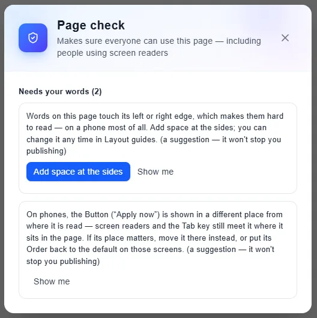](img/guide-page-check-order.webp)

[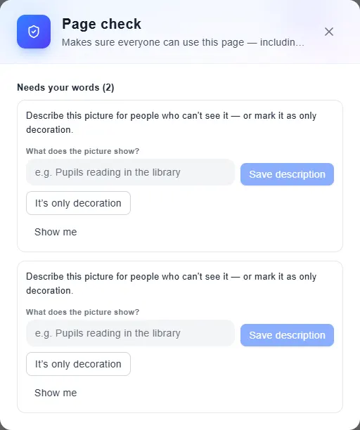](img/guide-page-check.webp)

[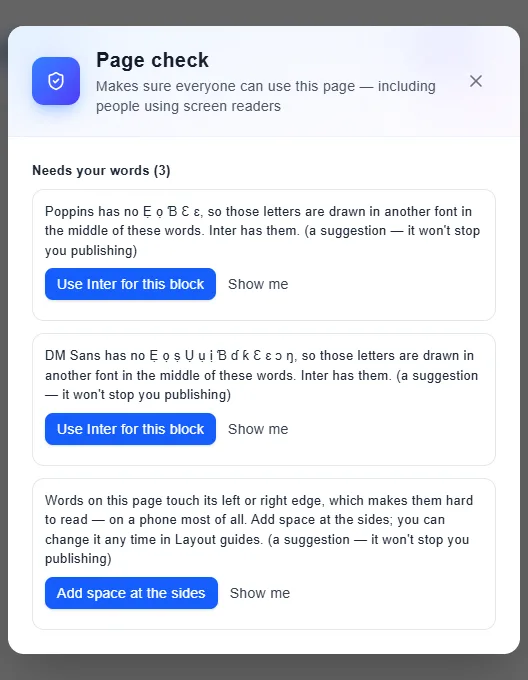](img/guide-page-check-fonts.webp)

## 14c. Sizing columns, and working on a smaller screen

- **How narrow a column can go, and how rows behave on a phone or tablet,** is told in the story:
  [§3](./layout-story.md#3-three-cards-across-that-stack-on-a-phone) (rows and grids on smaller screens),
  [§5](./layout-story.md#5-sizing-by-hand--and-the-one-pixel-of-slack) (sizing by hand) and
  [§6¾](./layout-story.md#6-the-whole-page-is-mine--the-page-grid) (the page grid). In short: a row stays side by side
  while every block's words keep about 14rem — and, on a phone, every block (a photo or a logo too) at least 10rem of the
  page's columns; when they would not, it stacks. Rows of four or more stay one row on a
  desktop unless their words would not fit (six Stats beside a sidebar go 3 + 3). Pages saved before 4 October 2026
  always stack on a phone.
- **Widening a block never makes it jump.** Pull it until its neighbour no longer fits, and the neighbour moves to the
  next line while your block stops exactly where you let go. Drag back and everything comes home.
- **On a smaller screen the page is shrunk to fit.** Choose Desktop 1280 on a laptop and the page is shown smaller
  (the zoom reads *Fit · 83%*) so all of it sits beside the panels — it is still laid out, and published, at full size.
  Everything you drag is still exact.
- **Zoom in when something is too small to work on.** A thin column, a small icon cell, a divider: press **+** beside
  the screen sizes, or pick a size from the zoom menu (Fit, 50–400%, or *Zoom to selection*). The page is drawn larger
  and scrolls both ways; hold **Space** (or the middle mouse button) and drag to move around it. Zoom only changes how
  big the page is drawn for you — what you drop, select and drag is stored exactly as at 100%, and the published page
  never changes.
  - Keyboard, with the pointer on the page: **Ctrl +** / **Ctrl −** step in and out, **Ctrl 0** is 100%, **Shift 1**
    fits the page, **Shift 2** zooms to the selected block. **Ctrl + scroll** (or a pinch) zooms round the spot under
    the pointer; scrolling alone still scrolls.
  - Over the panels and the Inspector, Ctrl + and Ctrl − are your browser's own zoom, so you can still make the whole
    builder bigger.
  - The handles and toolbars stay the same size at every zoom, so their buttons are always easy to hit.
  - The zoom you pick is remembered for each screen size on this computer; a screen size you never zoomed opens fitted.
    It is never saved into your site.
- **The Add-a-block panel sits beside the page** on a laptop and up, so nothing is ever hidden under it. It stays open
  while you work; close it with its ✕, **Esc** or **B**. On a phone it floats over the page and the Inspector slides in
  from the side.

## 15. Tips, gotchas & FAQ

- **"There's an empty container/row wrapping my block."** There isn't — the structural row and the page itself are invisible scaffolding: they're never selectable and never highlight on hover, so nothing empty appears around your block. Click your block (or anywhere in its row) and you select the block itself; the only highlight you see is the block's own selection box, hugging its content.
- **"Dragging my block made it full-width."** Fixed — moving a hugging (**Fit**) block in the layout keeps it hugging wherever it lands. Only a block you've set to **Full** or **Custom** fills the row. (Nothing changes its width just by being moved.)
- **"My block box is bigger than its content."** With **Width → Fit** a block always hugs its content exactly (in the layout and when floating) — no empty stretched box. If you *want* a larger box (e.g. a tall badge), size it with **Width/Height** and use **Content position** to place the content inside it.
- **"The page shows two sections I didn't add."** That's old saved data. Click **Reset**: it asks first, then replaces every page with one blank page; Ctrl+Z straight after puts your site back.
- **"Text size / bold / colour didn't change my component."** Make sure you selected the exact inner piece (the card's *title*, not the card). Each piece is edited on its own.
- **"I clicked a text block, started typing, and nothing appeared."** Fixed. Clicking a text block selects the band around it first — that is the drill‑down rule, and it is deliberate — but for a short while the editor read that as "you did not mean to be in this text" and took the cursor away a fraction of a second after the click. Click and type; the words land. The same fix cured its opposite: clicking the empty part of a box used to leave the cursor stranded in whatever text was nearest, and while it sat there **every keyboard shortcut silently did nothing** — Delete, `Ctrl+D`, the arrows, all of them.
- **"I clicked the first word of a heading and got something else."** Fixed, twice over. The **Blocks** launcher used to float over the top‑left corner of the page, so the first word of the first block opened the panel instead of taking the cursor — the canvas now reserves the button its own gutter, so it sits beside the page rather than on it. And the **resize handles** straddle a block's edge, which is where you grab to resize; because a block starts with no padding, its first letters sit under the left handle. A *drag* on a handle still resizes, but a *click* now goes through to the text under the pointer, with the cursor landing on the letter you actually aimed at.
- **"I can't get into the text without a mouse."** Fixed — select the block and press **Enter** (or **F2**). The cursor lands at the end of the existing words so you carry on typing; **Escape** steps back out.
- **"Resizing a stack leaves gaps I didn't ask for."** Fixed, and the rule is now simple: **dragging an edge that touches another stack moves that stack** — it gives or takes the room and the two stay together, whichever side you drag from, horizontally or vertically. A space only ever opens at an **outer edge**: the far left when nothing is to its left, the far right, the top, the bottom. That's the one case with no neighbour to share the boundary with, and it's deliberate. One case used to break the row outright: dragging the **left edge of the leftmost stack** pushed its neighbour onto a second line, because the gap was stored as a fixed size while the widths beside it are percentages, so the row added up to slightly more than 100%. The gap is now a share of the row like everything else, so it adds up exactly at any width and scales with the page.
- **"I made the stack I just dropped shorter and the one below it stayed where it was."** Fixed. A block you drop into empty space is set to **take the space that's there** — and when you then drag it shorter, that instruction now stands down, so the block below rides up to meet it and the room you freed collects at the **bottom of that column**, ready to build on. Blocks follow each other; leftover pools at the end.
- **"I shrank a stack from the top and now I can't drop anything into the space above it."** Fixed. Dragging a block's **top** edge down leaves empty space above it — and that space was a *margin*, which isn't a box, so there was nothing there to drop into. Dropping there did add a block, but the gap came along with your stack into the new arrangement, so the space stayed empty **and** your stack moved down. Now the newcomer **fills that space** and your block stays anchored where its bottom edge was. This works wherever you've made room — above a block, below a short one, or beside a narrowed one.
- **"I deleted one of my side-by-side blocks and now there's a gap I can't close."** Fixed. The deleted block's share of the row used to be left behind, so the row stopped filling its width — and dragging couldn't recover it, because dragging moves the boundary *between* two blocks and keeps their total the same. The freed width is now shared out **in proportion**: 20% / 20% / 60% becomes 25% / 75%, so the blocks keep the relationship you gave them and the row is full again. Stacked blocks and grids are untouched — they don't share a width that way.
- **"I widened a stack until its neighbour dropped below, dragged it back — and the page never came back."** Fixed. Once the neighbour had wrapped onto the next line the builder stopped recognising it as the block beside yours, so narrowing handed the width to nobody and the pair ended up 224 / 712 instead of 512 / 512. The neighbour is now always the next block in your layout, wherever it happens to be drawn. **Drag out and back and you land exactly where you started**, however many times you do it.
- **"I narrowed a stack and an empty space opened at the end of the line, with the other stack sitting underneath."** Fixed. As you narrow, the stack that wrapped below **comes back up as soon as it fits** and takes the rest of the line — it never leaves a hole beside you that it could have filled.
- **"I dropped a fourth block beside three others and it jumped onto a new line, leaving a big empty space."** Fixed. A block dropped onto a full line now takes **an equal share of that line** — two become thirds, three become quarters — and the blocks already there keep their proportions. The shares can never add up to more than the line, so nothing wraps and nothing leaves a hole. A block that hugs its content, such as a **Stat**, takes a share too when the line is full; where there is room it still hugs.
- **"A block that dropped onto its own line wouldn't get narrower."** Fixed. A block pushed onto a line by itself still **fills that line** — until you drag its edge yourself. From then on it's the size you dragged.
- **"My header stays at the top, but the sidebar slid under it and the page's words showed through the logo."** Fixed. A bar that stays at the top of the page now covers what scrolls beneath it — it takes the page's own colour when you have not given it one — and a sidebar that sticks while the article scrolls stops **below** the header instead of under it.
- **"I clicked a block and pressed Delete, and nothing happened."** Fixed. Clicking a block now gives it the keyboard, even straight after you clicked a button such as a screen size in the toolbar — Delete, the arrow keys and the shortcuts act on the block you picked.
- **"Four links side by side took two lines on a phone."** Fixed. On a phone, links in a line sit 1rem apart (2rem on larger screens), and links dropped straight on the page share one gutter at the line's ends instead of each carrying its own. A space you choose with **Space across** is kept on every screen.
- **"My Badge became a bar across the whole page."** Fixed. A Badge, a Stat and a Rating keep their own small size wherever they are dropped, on every screen.
- **"I set my sidebar to stay on screen and it shrank to a stub."** Fixed, for both ways of staying put. A **sidebar now fills the height of the screen** — a Stack sitting beside a column of content, whether you chose *Floats on screen* or *Sticks when reached*. (With *Floats on screen* the block is lifted out of the page, so nothing gives it a size any more: that's why a bar held at the **top** has to be given its width, and the same had never been done for a rail held at the **left** or **right**. With *Sticks when reached* it can't be as tall as the column beside it — a block with no room to travel can never stick — but it can be as tall as the screen, which is what a sidebar is.) A block held at a **corner** still hugs its contents (a chat bubble isn't a sidebar), a **button or heading** in a row is never stretched, and a height you set yourself always wins.
- **"My menu links jump to the right place, but the heading is hidden under the bar."** Fixed. A bar set to **Floats on screen** reserves no space, so the page runs underneath it — and the browser still thinks the top of the page is the very top, above anything you can see. Links now land the section *below* the bar, and the amount is the bar's real height, so it stays right when the bar's text wraps onto a second line or when two bars are stacked. This works in **Preview** as well as on the published site: in-page links used to do nothing at all in the preview, which was the one place you'd try them.
- **Everything saves automatically** to your browser. **Reset** wipes the current site back to a blank page — use it deliberately.

---

*This page is living documentation — if the builder changed and this didn't, please flag it.*
